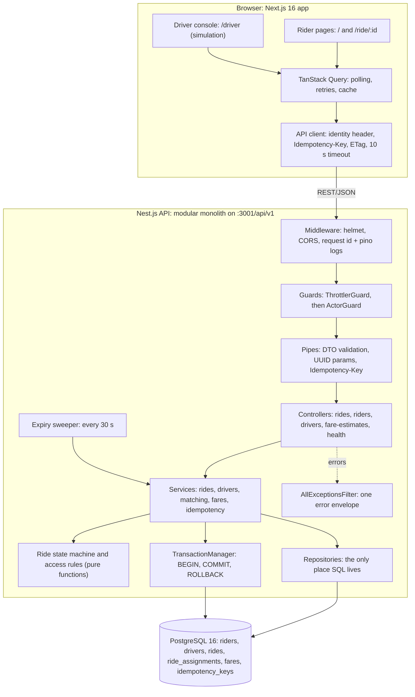
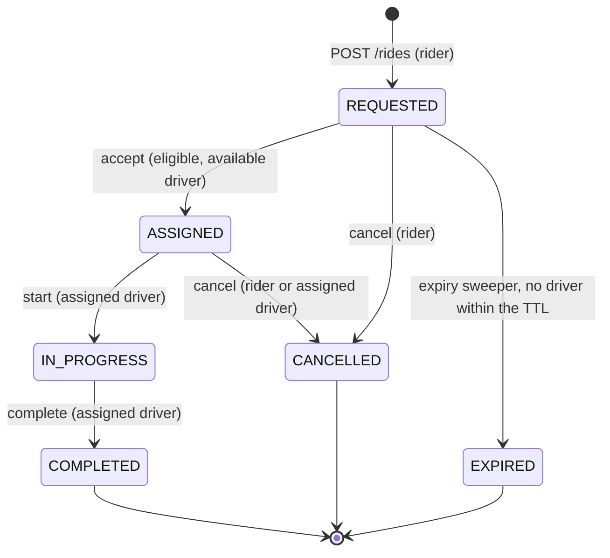
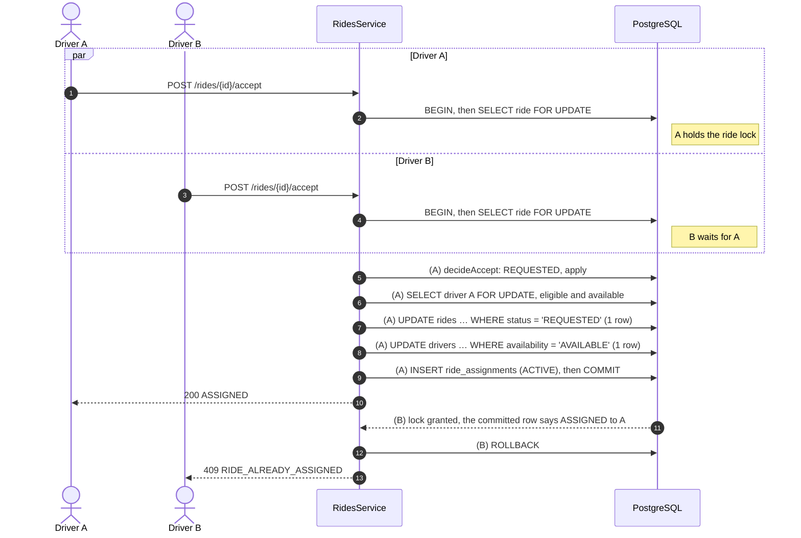

# Architecture

A simplified ride-hailing app for Lahore: a rider requests a ride, one driver gets it, and the ride moves through a strict lifecycle. This document answers the assessment's eight architecture questions, then lists assumptions, known limitations and improvements.

- Where and why the build departs from `docs/blueprint.md`: [DECISIONS.md](DECISIONS.md).
- How AI tools were used and checked: [AI_DISCLOSURE.md](AI_DISCLOSURE.md).

## System overview

**Runtime (Docker Compose):**
1. `postgres` starts and becomes healthy.
2. `migrate`, a one-shot job, applies migrations and the idempotent seed, then exits.
3. `backend` starts once migrate succeeds and becomes healthy.
4. `frontend` starts once the backend is healthy.

The app containers run as a non-root user on read-only filesystems, with no Linux capabilities (DECISIONS D23, D29).

### Ride lifecycle

The table of legal transitions, and who may make each one, lives in one pure module (`backend/src/rides/ride-state-machine.ts`). Every one of the 6 × 6 × 4 combinations of from-status, to-status and caller is tested. The checks run in a fixed order:
- **An impossible transition** is `409 INVALID_STATE_TRANSITION` for everyone.
- **A legal transition by the wrong party** is `403`.
- **A retry by the party that already made the change** returns `200` with the ride unchanged.

---

## 1. Why this stack and architecture?

| Choice | Why |
|---|---|
| **TypeScript end to end** | One language for UI, API and tests. The frontend's API types are *generated* from the backend's OpenAPI document, and CI fails if either side drifts, so contract bugs surface as compile errors. |
| **Nest.js modular monolith** | Its building blocks match the layering the brief asks for: guards (rate limit, identity), pipes (validation), controllers (thin HTTP), services (business rules) and filters (one error format). One deployable is the right size here; module boundaries keep a later split cheap. |
| **PostgreSQL as the single source of truth** | The hard requirement is "exactly one driver per ride, no duplicate rides, under concurrency". Row locks, compare-and-swap updates, partial unique indexes and ACID transactions solve that without Redis, a broker or distributed locks. |
| **Raw SQL repositories (`pg`) instead of an ORM** | Locking is the core of the design, so `SELECT … FOR UPDATE` and `UPDATE … WHERE status = …` stay visible and reviewable. SQL lives only in repositories. |
| **Next.js App Router, TanStack Query, react-hook-form + zod** | Polling, retry with backoff, caching and loading/error states come from a well-tested library. The booking screen's UI state is one pure function, `deriveBookingState`. |
| **Docker Compose** | `cp .env.example .env && docker compose up --build -d --wait` gives a reviewer the same stack that CI's end-to-end job tests. |

Tests: 453 backend unit, 107 backend integration (real PostgreSQL), 131 frontend unit and component, and 5 Playwright end-to-end tests. Details are in the README.

## 2. How do you prevent two drivers from accepting the same ride?

Three independent layers. Each one alone keeps a single winner; the integration tests prove that by removing them one at a time (AI_DISCLOSURE, Phase 4).

1. **Row locks in a fixed order.** `POST /rides/{id}/accept` runs in one READ COMMITTED transaction. It first runs `SELECT … FROM rides WHERE id = $1 FOR UPDATE`, then locks the driver row the same way.
   - A second accepter blocks on the ride lock. Once the first transaction commits, it re-reads the *committed* row, sees `ASSIGNED`, and gets `409 RIDE_ALREADY_ASSIGNED`.
   - Every lifecycle operation (accept, start, cancel, complete) locks **ride, then driver**, so there are no deadlocks.
2. **Compare-and-swap writes.**
   - The ride: `UPDATE rides SET status = 'ASSIGNED', … WHERE id = $1 AND status = 'REQUESTED'`.
   - The driver: `UPDATE drivers SET availability = 'BUSY' WHERE id = $1 AND availability = 'AVAILABLE'`.
   - Each must change exactly one row, or the transaction rolls back with a 409. This stays correct even if the lock were removed.
3. **Database invariants.** Partial unique indexes allow at most one `ACTIVE` assignment per ride and one per driver (`uq_active_assignment_per_ride`, `uq_active_assignment_per_driver`). Even a buggy code path cannot commit two winners.

**Locks stay short.** The pool sets `lock_timeout` to 3 s and `statement_timeout` to 5 s, so a stuck lock fails fast with a retryable `503` instead of exhausting the pool.

**Why not `SERIALIZABLE`?** It works, but it needs retry loops and is harder to reason about. Explicit locks are simpler and cheaper here. `SELECT … FOR UPDATE SKIP LOCKED` would be the tool for a dispatcher consuming a queue of rides (see Q5).

**Proof:**
- Integration test: 10 drivers accept the same ride at once, repeated 20 times. Every run has exactly one winner and a consistent database afterwards.
- The diagram above is reproduced deterministically: the test checks that B is waiting on the lock, using `pg_stat_activity`.
- An end-to-end test has two browsers press Accept at the same moment.

## 3. How do you handle retries and duplicate requests?

**Ride creation is idempotent per intent.**
- **One key per intent.** The client generates one `Idempotency-Key` (a UUID) per ride-request intent and reuses it on every retry. A changed trip, category or rider gets a new key.
- **Claim in the same transaction as the ride.** The API claims the key with `INSERT INTO idempotency_keys … ON CONFLICT (rider_id, key) DO NOTHING`. That claim, the ride insert, the fare quote and the stored response all happen in **one transaction**, so a key is either fully processed with a stored response, or not claimed at all.
- **Retry with the same body:** the original response is replayed: `200` with `Idempotent-Replayed: true`, byte-identical to the first answer.
- **A concurrent duplicate** blocks on the unique index until the first transaction commits, then gets the replay.
- **Same key, different body:** `422 IDEMPOTENCY_KEY_REUSED`. The body is compared as a SHA-256 hash of its canonical JSON.

**A business-level guard sits on top.** A partial unique index allows one active ride per rider (`uq_one_active_ride_per_rider`). A new intent while a ride is active returns `409 ACTIVE_RIDE_EXISTS` with the active ride's id, and the UI opens that ride.

**Lifecycle calls are idempotent for the party that made them.** Retrying accept, start, cancel or complete returns `200` with the current ride and changes nothing.

**The client never retries a write behind the user's back.**
- Reads retry up to 3 times with exponential backoff, only on network errors or 5xx.
- Writes are retried only when the user presses Retry, and for `POST /rides` that reuses the key.
- A synchronous in-flight guard blocks double-clicks.

**Proof:**
- 10 identical requests in parallel create exactly one ride.
- A component test checks that the retry sends the *same* key.
- In an end-to-end test, the API commits the ride but the browser never receives the response. The retry is answered with a replay, not a second booking.

## 4. How does the frontend respond when an API request fails?

Every failure becomes a typed `ApiError` (code, status, request id, details). Each case has one defined behaviour (blueprint 5.4.4):

| Failure | What the user sees |
|---|---|
| Network error or 10 s timeout on a read (ride status, offers) | The last known data stays on screen with a "Reconnecting…" banner and a "Retry now" button. Retries back off at 1, 2 and 4 s, then poll every 10 s. "Retry now" works even mid-backoff. |
| Network error, timeout or 5xx on `POST /rides` | Inline "Your ride was not requested" with Retry, using the **same** Idempotency-Key, and a note that retrying cannot double-book. |
| 400 validation | Field errors appear under the matching input. The backend's `details.fields` paths (`pickup.lat`, `destination`) are mapped to form fields. |
| 404 ride, or a ride the user may not see | A "Ride not found" page with a link home. Polling stops. |
| 409 conflict | Contextual copy, then the authoritative state is refetched. Examples: "Trip already started, can't cancel."; "Another driver took this ride."; for `ACTIVE_RIDE_EXISTS`, the existing ride opens. |
| 429 rate limited | The action is disabled with a countdown from `Retry-After`. |
| 5xx | A generic message plus the **request id** ("Reference: …"), which matches the server's log lines, and Retry. |
| Unexpected render error | The `error.tsx` boundary shows "Something went wrong" with Try again. No internals are shown. |

Ride polling (every 3 s) stops on a terminal status, pauses while the tab is hidden, and sends `If-None-Match`, so an unchanged ride costs a `304` with no body. All of this is covered by component tests (blueprint 17–20) and end-to-end tests (21–23).

## 5. How would you scale to multiple cities and thousands of concurrent users?

1. **Stateless API replicas behind a load balancer.** The API holds no session state, and the expiry sweeper is safe on every replica because it is a single conditional `UPDATE`. One exception: the rate-limit counters are in memory per instance, so they move to Redis (see Q6) as soon as there is more than one replica.
2. **Connection pooling and read scaling.** PgBouncer in front of Postgres. Status polling and driver offers can go to read replicas; lifecycle writes stay on the primary.
3. **Partition by city.** Cities are naturally isolated: a Lahore ride never matches a Karachi driver. Add `city_id`, then partition tables or run one database and deployment cell per city. This also limits the blast radius of an outage to one city.
4. **A real geo-index for nearby drivers.** Replace the bounding box plus Haversine scan with PostGIS (`geography` + GiST + `ST_DWithin`), or H3 cells in Redis for hot driver presence. Pickup ETAs come from a routing engine (OSRM or Valhalla) instead of straight-line distance × 1.3.
5. **Keep GPS pings off the OLTP database.** Drivers stream locations to a location service that keeps the latest position, with a TTL, in Redis. Only trip-relevant state reaches Postgres.
6. **Push instead of polling.** WebSocket or SSE gateways push ride status. Polling with ETags is a fine start but scales linearly with open screens.
7. **Dispatch as a queue.** At scale, send sequential offers with timeouts instead of letting every nearby driver pull. A dispatcher can take rides with `FOR UPDATE SKIP LOCKED`, and the same row-lock and compare-and-swap rules still guarantee one winner.

## 6. When would you introduce Redis, a message broker, or separate services?

- **Redis**
  - **When there is more than one API replica:** rate-limit counters must be shared. `@nestjs/throttler` takes a pluggable storage, so a Redis-backed one drops in.
  - **When driver location updates or nearby-driver queries start to dominate database load:** presence with a TTL, GEO commands or H3 cells.
  - **For hot caches:** for example ride status for push gateways, or surge multipliers per area.
- **A message broker (Kafka, RabbitMQ, SQS), with a transactional outbox**
  - **When work happens beyond the request:** notifications, payments, receipts, analytics.
  - **When dispatch becomes asynchronous,** with offer timeouts and retries.

  The outbox writes events in the same transaction as the state change, so events are never lost or invented.
- **Separate services**
  - **When teams or scaling profiles diverge**, not before.
  - **First candidates:** Location (very high write volume, latency-sensitive) and Dispatch (CPU and latency profile).
  - **Trips and payments stay transactional** with clear ownership.

  The current module boundaries (rides, drivers, matching, fares, idempotency) are the seams to cut along.

## 7. How would you deploy, monitor, and roll back?

- **Build:**
  - CI already runs lint, types, unit, integration (real Postgres), API-contract drift and end-to-end tests on every push (`.github/workflows/ci.yml`).
  - On `main`, it would also push both images tagged with the git SHA to a registry.
- **Deploy:**
  - Run on ECS, Kubernetes or Fly.io; the containers are already non-root, read-only and health-checked.
  - **Migrations run as a separate pre-deploy job**, exactly like the Compose `migrate` service (DECISIONS D1). They use expand/contract (add a column, deploy code that writes both, backfill, then remove the old column), so the previous release keeps working against the new schema.
  - **Roll out blue/green or canary**, gated on `/health/ready`, which checks the database, and on error-rate and latency objectives.
- **Monitor:**
  - **Logs:** structured JSON with a request id on every line and response, plus business events (`ride.requested`, `ride.assigned`, `ride.expired`, …).
  - **Metrics:**
    - request rate, errors and duration per endpoint;
    - database pool saturation;
    - lock-timeout `503`s, which signal contention;
    - the `409 RIDE_ALREADY_ASSIGNED` rate (accept races) and the expired-ride rate (no supply);
    - how long rides sit in `REQUESTED`.
  - **Traces** via OpenTelemetry; error tracking via Sentry.
  - **Alerts** on the 5xx rate, p95 latency, lock timeouts, and rides stuck in `REQUESTED`.
- **Roll back:**
  - Redeploy the previous image tag. That is safe because schema changes are backward compatible.
  - Risky features ship behind flags that can be switched off without a deploy.
  - Database backups with point-in-time recovery cover data mistakes.

## 8. Three most important improvements before production

1. **Real authentication and authorization.**
   - Replace the demo `X-Rider-Id`/`X-Driver-Id` headers with OIDC/JWT, verified rider and driver accounts, and role-based access.
   - The swap is contained: `ActorGuard` and `IdentityService` are the only code that knows how a caller is identified.
   - It also makes rate limits key on the authenticated user rather than a spoofable header.
2. **Real dispatch and realtime delivery.**
   - **Nearby drivers:** a geo-index, live driver GPS, and sequential offers with timeouts.
   - **Status updates:** pushed over WebSocket/SSE instead of polled.
   - **Events:** an outbox for side effects.
   - **Driver cancels:** a driver's cancel puts the ride back into the queue instead of ending it.
3. **Operational hardening.**
   - Metrics, tracing and alerts (Q7), and a shared rate-limit store.
   - Load and chaos tests of the accept path.
   - Backups with point-in-time recovery and restore drills.
   - Payments with a fare and surge engine that keeps an audit trail.

---

## Assumptions

- **Places:** pickup and destination are chosen from 12 fixed Lahore landmarks; there is no geocoding. The service area is a bounding box (lat 31.35–31.70, lng 74.10–74.55), and trips must be at least 200 m long.
- **Distance and time:** road distance is Haversine × 1.3, and trip duration assumes 24 km/h. Pickup ETA is the nearest eligible driver's road distance (also straight line × 1.3) at 25 km/h, plus 1 minute.
- **Fares:** whole PKR, computed as `max(minimum, base + per-km + per-minute) × surge(1.0)`.
  - Economy: base 150, 40 per km, 5 per minute, minimum 250.
  - Comfort: base 250, 65 per km, 8 per minute, minimum 400.
  - The final fare equals the quote.
- **Matching:** Comfort cars may take Economy rides, but not the reverse. Drivers see open requests within 5 km. The rider's ETA uses the same radius, so a rider is never shown an ETA from a driver who cannot see the ride.
- **Rides:**
  - one active ride per rider;
  - an unaccepted request expires after 5 minutes;
  - `POST /rides/{id}/start` was added, because "complete" should require a trip in progress;
  - a rider may cancel before the trip starts, and the assigned driver may cancel while assigned.

## Known limitations

- **Identity:** demo identity via headers, with no real authentication. Rate limits key on that spoofable header.
- **Distance:** straight-line, not road-network routing. The map is a placeholder with no tiles or streets.
- **Delivery:** polling, not push. Driver locations are reported manually in the console, not streamed.
- **Dispatch:** pull-based offers, not sequential dispatch. A driver's cancel ends the ride rather than re-queuing it.
- **Out of scope:** payments, ratings, ride history and surge pricing.
- **Rate limiting:** counters are in memory per API instance (fine for one replica).
- **Browser hardening:** the CSP still needs inline scripts, because Next.js's bootstrap scripts are not nonce-based.
- **UI:** light theme only.
- **Data:** a single PostgreSQL database with no city partitioning.
