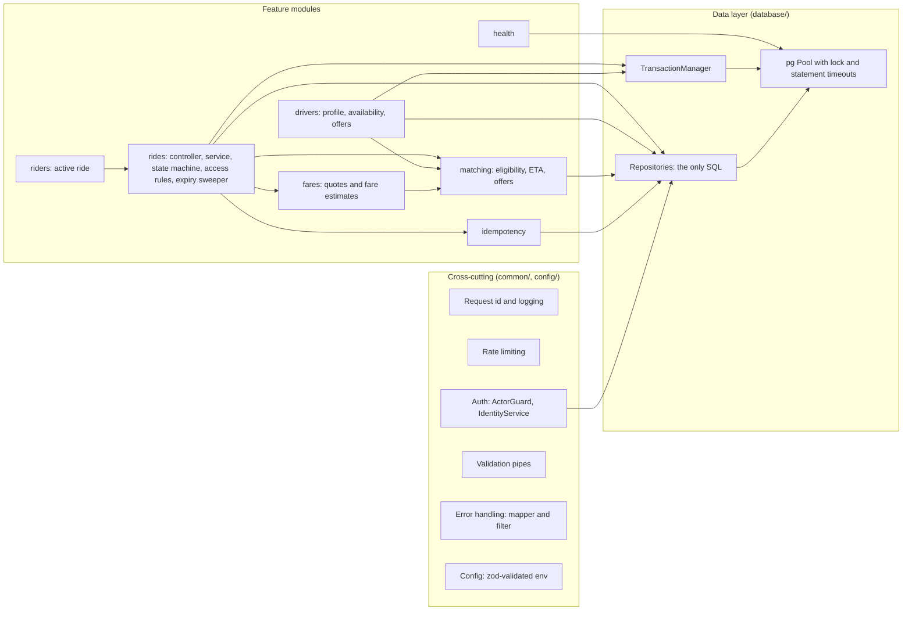
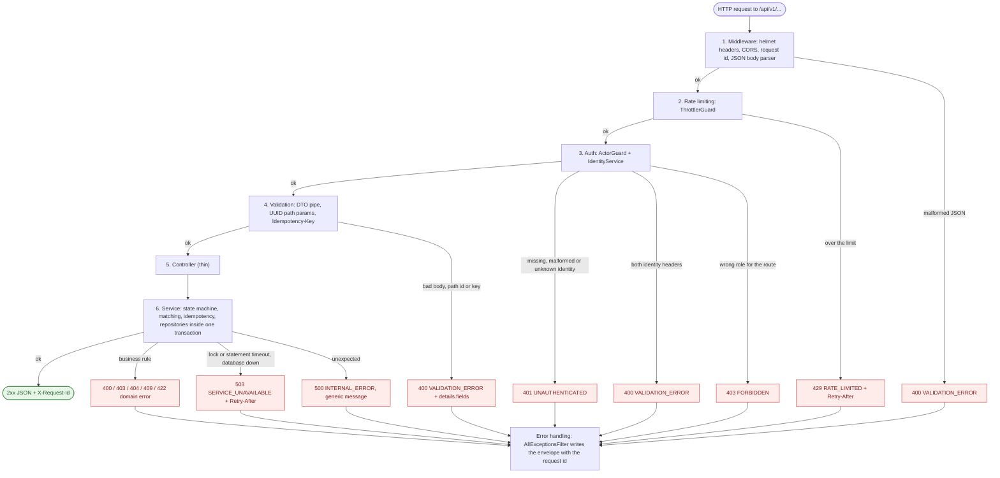
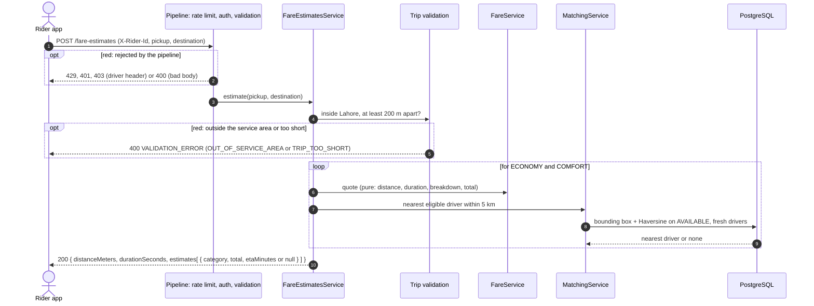
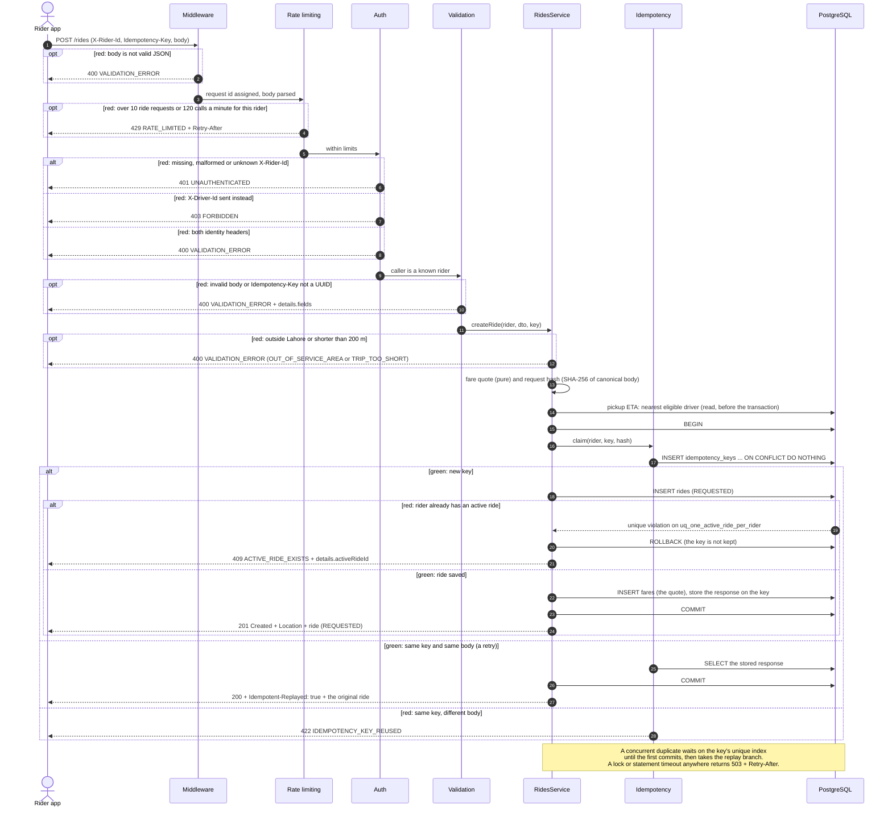
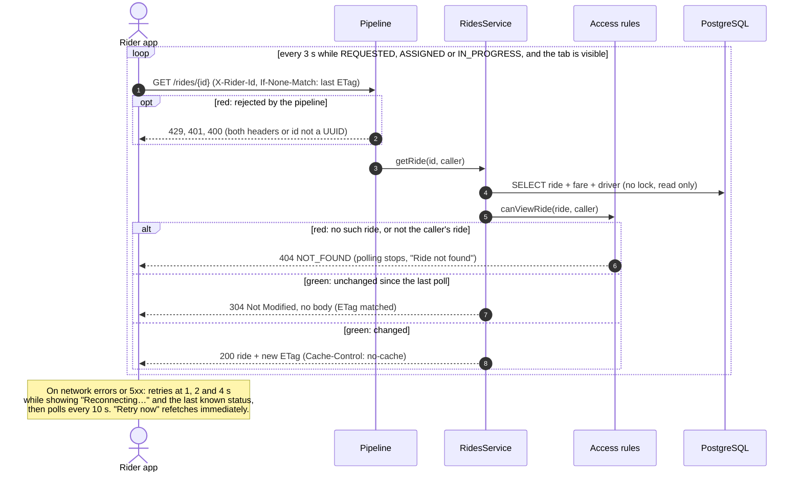
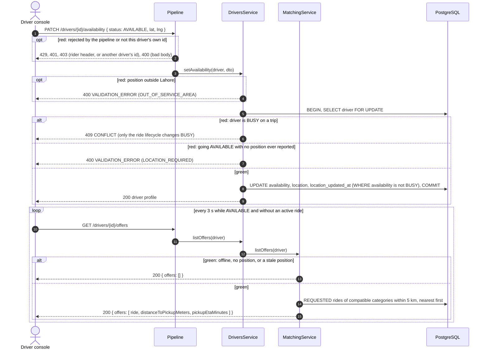
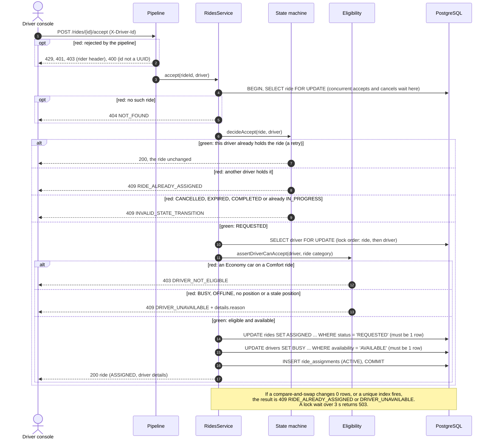
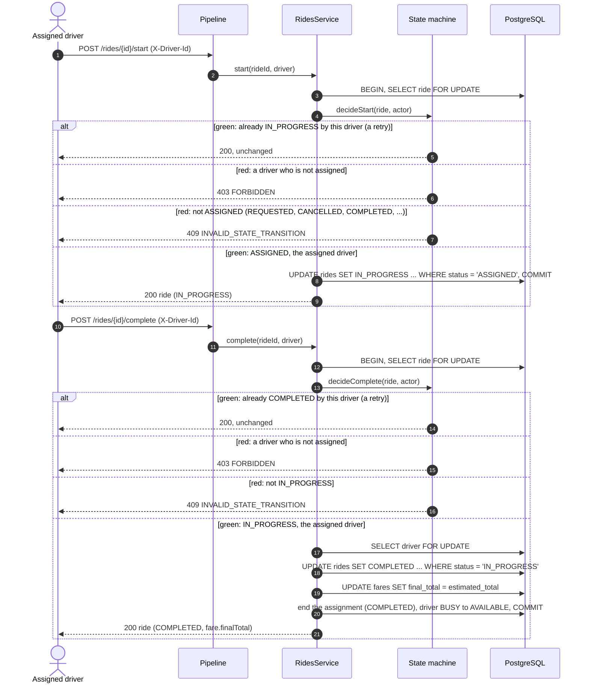
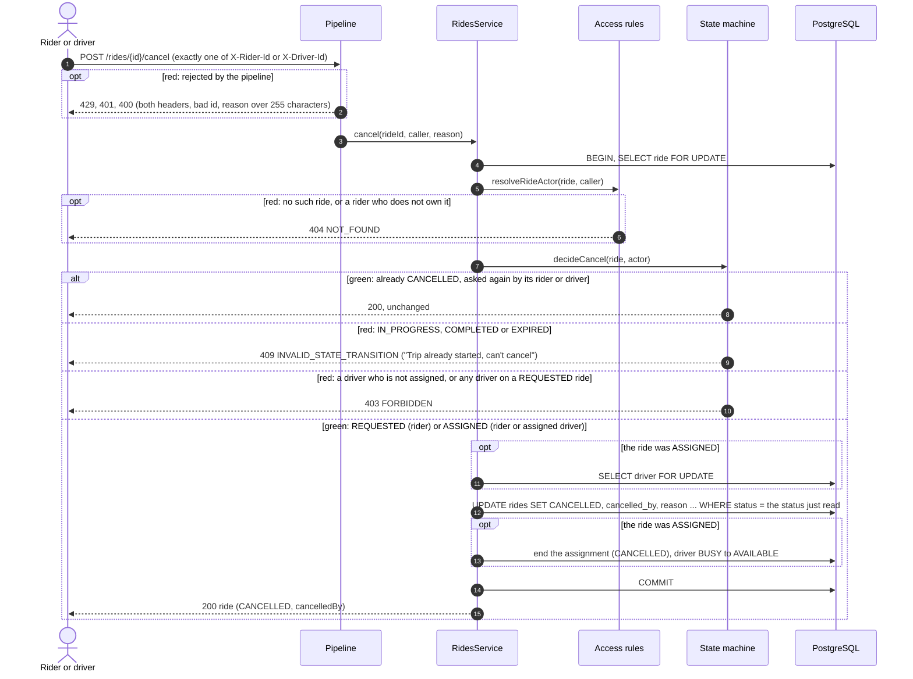
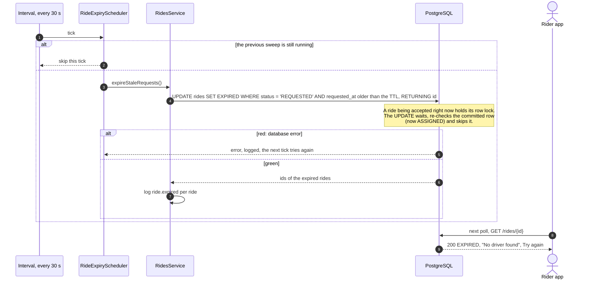

# System guide: glossary, modules and request flows

For engineers joining the project. It explains **how** a request moves through the backend and which module accepts or rejects it, and why. [ARCHITECTURE.md](ARCHITECTURE.md) explains **why** the system is built this way; [DECISIONS.md](DECISIONS.md) records where it departs from the blueprint.

1. [Glossary](#1-glossary)
2. [Module map](#2-module-map)
3. [Core modules](#3-core-modules): state machine, transactions and concurrency control, idempotency, auth, rate limiting, error handling, expiry sweeper
4. [Request flows](#4-request-flows): green and red paths for every endpoint
5. [Red paths at a glance](#5-red-paths-at-a-glance)

Backend paths below are relative to `backend/src/`; frontend paths start with `frontend/`.

---

## 1. Glossary

### Domain

| Term | Meaning | In the code |
|---|---|---|
| **Rider** | The person requesting a ride. Identified by `X-Rider-Id` (a seeded UUID; see *demo identity*). | `riders` table, `riders/` |
| **Driver** | The person driving one vehicle of one category. Identified by `X-Driver-Id`. | `drivers` table, `drivers/` |
| **Ride category** | `ECONOMY` or `COMFORT`. A Comfort car may serve an Economy ride; an Economy car may never serve a Comfort ride. | `matching/eligibility.ts` (`canServe`) |
| **Ride status** | `REQUESTED` → `ASSIGNED` → `IN_PROGRESS` → `COMPLETED`, or `CANCELLED`, or `EXPIRED`. | `rides/ride-status.ts` |
| **Terminal status** | `COMPLETED`, `CANCELLED` or `EXPIRED`. A ride in a terminal status never changes again. | `rides/ride-state-machine.ts` |
| **Transition** | A move from one status to another, e.g. *accept* moves `REQUESTED` to `ASSIGNED`. | `TRANSITIONS` table |
| **Ride actor** | The caller's relationship to one particular ride: `RIDER` (its owner), `ASSIGNED_DRIVER`, `DRIVER` (any other driver) or `SYSTEM` (the expiry sweeper). Permissions are expressed in these terms. | `rides/ride-access.ts` (`resolveRideActor`) |
| **Assignment** | A `ride_assignments` row linking a ride to its driver. It is `ACTIVE` during the trip, then `COMPLETED` or `CANCELLED`. There is at most one active assignment per ride and per driver. | `rides/ride-assignments.repository.ts` |
| **Driver availability** | `OFFLINE`, `AVAILABLE` or `BUSY`. Drivers toggle `OFFLINE`/`AVAILABLE`; only the ride lifecycle sets or clears `BUSY`. | `drivers/` |
| **Location freshness** | A driver's reported position only counts if it is younger than `DRIVER_LOCATION_TTL_SECONDS`. | `matching/eligibility.ts` (`isLocationFresh`) |
| **Offer** | A `REQUESTED` ride that a driver could accept now: a compatible category, and a pickup within the offer radius of the driver. | `matching/matching.service.ts` (`listOffers`) |
| **Offer radius** | `MAX_OFFER_RADIUS_KM` (default 5 km, straight-line). The same radius bounds the rider's pickup ETA, so a rider never sees an ETA from a driver who cannot see the ride. | `config/env.schema.ts` |
| **Pickup ETA** | Minutes until the nearest eligible driver could arrive: road distance (straight line × 1.3) at 25 km/h, plus 1 minute. `null` means no driver is nearby. | `matching/eligibility.ts` (`pickupEtaMinutes`) |
| **Fare quote** | Whole-rupee price with a breakdown (base, distance, time, surge, minimum applied). It is stored in `fares` when the ride is created. At completion the **final fare** is set to the quote. | `fares/fare.service.ts` |
| **Service area** | The Lahore bounding box. A pickup or destination outside it is rejected with `OUT_OF_SERVICE_AREA`; a trip shorter than 200 m with `TRIP_TOO_SHORT`. | `rides/trip-validation.ts` |
| **Landmark** | One of the 12 fixed Lahore places the UI offers instead of free-text geocoding. | `frontend/src/lib/landmarks.ts` |
| **Demo identity** | The `X-Rider-Id`/`X-Driver-Id` headers carrying seeded UUIDs, a documented stand-in for real authentication. | `common/auth/`, `seed/seed-data.ts` |

### Correctness and concurrency

| Term | Meaning | In the code |
|---|---|---|
| **Concurrency control** | Keeping data correct when requests run at the same time, e.g. two drivers accepting one ride, or a rider cancelling while a driver accepts. There are four layers: transactions, row locks taken in a fixed order, compare-and-swap writes, and unique-index backstops. Each would keep a single winner on its own. | `rides/rides.service.ts`, repositories, `migrations/` |
| **Transaction (ACID)** | A unit of work that fully commits or fully rolls back. Every state change runs in one `TransactionManager.run()` call: `BEGIN`, the work, `COMMIT`, and `ROLLBACK` on any error. Example: a ride and its fare quote and stored idempotency response are saved together or not at all. | `database/transaction-manager.ts` |
| **READ COMMITTED** | Postgres' default isolation level, used here. It is sufficient because the code takes explicit row locks, and a blocked statement re-reads the *committed* row once the lock is released. | `database/transaction-manager.ts` |
| **Row lock** | `SELECT … FOR UPDATE`. Every other transaction that wants the same row waits until the holder commits or rolls back. | `rides.repository.ts`, `drivers.repository.ts` (`findByIdForUpdate`) |
| **Lock order** | Every lifecycle operation locks the **ride first, then the driver**. A fixed order makes deadlocks impossible. | `rides/rides.service.ts` |
| **Compare-and-swap (CAS)** | A conditional write such as `UPDATE rides SET status = 'ASSIGNED' … WHERE id = $1 AND status = 'REQUESTED'`. If the expected state changed, zero rows are updated and the service rejects the request. | `rides.repository.ts` (`markAssigned`, `markStarted`, …) |
| **Partial unique index (backstop)** | A database rule that makes an impossible state impossible to commit, even through a buggy code path. Examples: one active ride per rider, one active assignment per ride and per driver. | `migrations/1793491200000_init.sql` |
| **Lock timeout** | `lock_timeout` (3 s) and `statement_timeout` (5 s) on every connection. A stuck lock fails fast as a retryable `503` instead of hanging. | `database/pg-pool.provider.ts` |
| **Idempotency** | Repeating a request has the same effect as sending it once. Retries and double-clicks never create a second ride. | `idempotency/` |
| **Idempotency-Key** | A UUID header on `POST /rides`. The client creates one per *intent* and reuses it on every retry of that intent. | `common/http/idempotency-key.decorator.ts` |
| **Intent** | One "request this trip" decision by a rider. A changed trip, category or rider is a new intent and gets a new key. | `frontend/src/lib/idempotency.ts` (`IntentKeyStore`) |
| **Request hash** | SHA-256 of the canonical JSON request body. Reusing a key with a *different* body is rejected with `422`. | `common/utils/canonical-json.ts` |
| **Replay** | The stored original response returned for a repeated key: `200` with `Idempotent-Replayed: true`, byte-identical to the first answer. | `idempotency/idempotency.service.ts` |
| **Idempotent lifecycle call** (`ALREADY_DONE`) | A repeated accept, start, cancel or complete by the party that already did it returns `200` with the current ride and changes nothing. | `rides/ride-state-machine.ts` (`decide*`) |
| **Expiry sweeper** | A background job that every 30 s moves `REQUESTED` rides older than `RIDE_REQUEST_TTL_SECONDS` (default 300 s) to `EXPIRED`, so a rider is never left waiting forever. | `rides/ride-expiry.scheduler.ts` |

### API and operations

| Term | Meaning | In the code |
|---|---|---|
| **Rate limiting (throttling)** | Caps calls per caller per time window: 120 per minute in general, and 10 ride requests per minute. Excess calls get `429` with `Retry-After`. | `common/rate-limit/` |
| **Tracker (bucket key)** | What a rate limit counts against: the identity header when it is a valid UUID, otherwise the client IP. | `trackRequester()` |
| **Actor guard** | The global guard that turns identity headers into a verified caller and enforces who may call each route. | `common/auth/actor.guard.ts` |
| **Error envelope** | The single error shape: `{ "error": { "code", "message", "details?", "requestId" } }`. | `common/http/all-exceptions.filter.ts` |
| **Error code** | A stable machine-readable error name such as `RIDE_ALREADY_ASSIGNED`. Clients branch on it, never on the message. | `common/errors/error-codes.ts` |
| **Domain error** | A typed error raised by business rules, carrying its code, HTTP status and details. | `common/errors/domain-errors.ts` |
| **Request id** | `X-Request-Id`: reused from the caller if it is safe, otherwise generated. It is echoed on every response, attached to every log line and included in every error. | `common/http/request-id.ts` |
| **Field errors** | `details.fields: [{ field: "pickup.lat", message, code? }]` on a `400`, so the UI can mark the right input. | `common/http/validation.ts` |
| **ETag / conditional GET** | `GET /rides/{id}` returns an `ETag`. The client sends it back as `If-None-Match`, and an unchanged ride costs a `304` with no body. That makes 3-second polling cheap. | `rides/rides.controller.ts`, `frontend/src/lib/api.ts` |
| **Migration / migrate job** | Versioned SQL schema changes (node-pg-migrate). In Docker a one-shot `migrate` service applies them, plus the idempotent seed, before the API starts. | `migrations/`, `scripts/migrate.ts` |
| **Seed / seed reset** | Inserts the demo riders and drivers. A reset also deletes all rides and restores the drivers' seeded state. | `seed/` |
| **OpenAPI contract** | `backend/openapi.json`, exported from the code. The frontend's types are generated from it; CI fails if either drifts. | `scripts/export-openapi.ts` |
| **Liveness / readiness** | `GET /health/live` reports the process is up; `GET /health/ready` also checks the database (503 when it is down). | `health/` |

---

## 2. Module map



| Module | Folder | Responsibility |
|---|---|---|
| Config | `config/` | Validates every environment variable at startup with zod; a bad value stops the boot and names the variable. |
| Request id and logging | `common/logging/`, `common/http/request-id.ts` | JSON logs (pino) with a request id on every line, with sensitive headers redacted. |
| Rate limiting | `common/rate-limit/` | Per-caller limits; see [3.5](#35-rate-limiting). |
| Auth | `common/auth/` | Identity headers to a verified caller, and who may call what; see [3.4](#34-auth-authentication-and-authorization). |
| Validation | `common/http/validation.ts`, `pipes.ts`, DTOs | Strict request shapes: unknown fields are rejected and errors are flattened to field paths. |
| Error handling | `common/errors/`, `common/http/error-mapper.ts`, `all-exceptions.filter.ts` | One error envelope for every failure; see [3.6](#36-error-handling). |
| Rides | `rides/` | The ride lifecycle: create, read, accept, start, cancel, complete and expire. Owns the state machine. |
| Drivers | `drivers/` | A driver's own profile, availability, location and offers. |
| Riders | `riders/` | The rider's current active ride, used to restore the UI after a refresh. |
| Fares | `fares/` | Pure fare quotes, persisted quotes, and fare estimates for both categories. |
| Matching | `matching/` | Category eligibility, location freshness, nearest-driver ETA and offer lists (bounding-box prefilter plus Haversine in SQL). |
| Idempotency | `idempotency/` | Claiming a key and storing and replaying the response; see [3.3](#33-idempotency). |
| Data layer | `database/` | Pool, transactions, migrations and SQL helpers. Repositories are the only place SQL lives. |
| Health | `health/` | Liveness and readiness. |

---

## 3. Core modules

### 3.1 State machine

**Responsibility:** decide whether a ride may move from one status to another, and who may make that move. It is the single source of truth for lifecycle rules. It is pure: no database, no I/O.

**Where:** `rides/ride-state-machine.ts` (the transition table and the `decide*` functions) and `rides/ride-access.ts` (who the caller is to this ride, and who may view it).

**How it works:**
- `TRANSITIONS` lists, for every status, the statuses it may move to and the ride actors allowed to make each move:

  | From | To | Allowed ride actors |
  |---|---|---|
  | `REQUESTED` | `ASSIGNED` | `DRIVER` (any eligible driver) |
  | `REQUESTED` | `CANCELLED` | `RIDER` |
  | `REQUESTED` | `EXPIRED` | `SYSTEM` |
  | `ASSIGNED` | `IN_PROGRESS` | `ASSIGNED_DRIVER` |
  | `ASSIGNED` | `CANCELLED` | `RIDER`, `ASSIGNED_DRIVER` |
  | `IN_PROGRESS` | `COMPLETED` | `ASSIGNED_DRIVER` |
  | `COMPLETED`, `CANCELLED`, `EXPIRED` | (none) | (terminal) |

- `decideAccept`, `decideStart`, `decideCancel` and `decideComplete` each return `APPLY` (perform the change) or `ALREADY_DONE` (this caller already made it: return `200` and change nothing), or throw the exact error.
- **State before permission.** An impossible move is `409` for everyone; a possible move by the wrong party is `403`.
- The services call these functions *after* taking the row lock, then perform the write as a compare-and-swap. The rule is therefore checked against the current, locked row and re-enforced by SQL.

**Rejects:**

| Situation | Response |
|---|---|
| The transition does not exist (e.g. complete a `REQUESTED` ride, cancel an `IN_PROGRESS` one, anything from a terminal status) | `409 INVALID_STATE_TRANSITION`, with `details: { currentStatus, attempted }` |
| The transition exists but this caller may not make it (e.g. a driver who is not assigned starts the trip) | `403 FORBIDDEN` |
| Accepting a ride that another driver holds | `409 RIDE_ALREADY_ASSIGNED` |
| A rider who does not own the ride (any operation) | `404 NOT_FOUND`, so ride ids cannot be probed |

**Tested by:**
- `ride-state-machine.spec.ts`, which checks all 144 combinations of from-status, to-status and actor;
- `ride-access.spec.ts`;
- `transitions.int-spec.ts`, which runs 18 illegal moves and checks the database is byte-identical before and after each.

### 3.2 Transactions and concurrency control

**Responsibility:** guarantee that every state change is all-or-nothing (ACID), and that simultaneous requests can never break the invariants: one driver per ride, one active ride per rider, one active trip per driver.

**Where:**
- `database/transaction-manager.ts` (`run`);
- `database/pg-pool.provider.ts` (timeouts);
- the lock and CAS methods in `rides/rides.repository.ts` and `drivers/drivers.repository.ts`;
- the partial unique indexes in `migrations/`.

**How it works, per lifecycle call (accept, start, cancel, complete):**
1. `BEGIN` (READ COMMITTED) on one pooled connection.
2. `SELECT … FROM rides WHERE id = $1 FOR UPDATE`. Concurrent calls on the same ride queue here.
3. Ask the state machine (3.1).
4. If a driver is involved, `SELECT … FROM drivers WHERE id = $1 FOR UPDATE`. The order is always ride, then driver.
5. Compare-and-swap writes; each must change exactly one row:
   - `UPDATE rides … WHERE id = $1 AND status = '<expected>'`;
   - `UPDATE drivers … WHERE availability = '<expected>'`;
   - insert or end the assignment.
6. `COMMIT`. On any error, `ROLLBACK`, and the connection is always released.

**Backstops:** `uq_one_active_ride_per_rider`, `uq_active_assignment_per_ride` and `uq_active_assignment_per_driver`. If one ever fires, the service translates it into the same error the normal check would have produced.

**Rejects:**

| Situation | Response |
|---|---|
| A compare-and-swap updated 0 rows (state changed underneath) | `409` (`RIDE_ALREADY_ASSIGNED`, `DRIVER_UNAVAILABLE` or `CONFLICT`) |
| A lock wait longer than 3 s, or a statement longer than 5 s | `503 SERVICE_UNAVAILABLE` with `Retry-After: 1` and `details.retryable: true` |
| Database unreachable | `503 SERVICE_UNAVAILABLE` |

**Tested by:** `concurrency.int-spec.ts`:
- 10 drivers accept the same ride at once, ×20;
- one driver accepts two rides at once, ×20;
- accept races cancel and start races cancel, in both forced orders;
- the lock wait is reproduced through `pg_stat_activity`.

Also `database-constraints.int-spec.ts` and `transaction-manager.spec.ts`.

### 3.3 Idempotency

**Responsibility:** make `POST /rides` safe to retry. However many times the same intent arrives, at most one ride is created, and every retry gets the same answer.

**Where:**
- `idempotency/idempotency.service.ts` (`claim`, `complete`, `hashRequest`);
- `idempotency/idempotency.repository.ts`;
- `rides/rides.service.ts` (`createRide`);
- client side, `frontend/src/lib/idempotency.ts`.

**How it works:**
1. The client sends `Idempotency-Key: <uuid>`, one per intent, reused on every retry.
2. Inside the create transaction, the API runs `INSERT INTO idempotency_keys (rider_id, key, request_hash) … ON CONFLICT (rider_id, key) DO NOTHING`.
   - **One row inserted:** the key is new. Create the ride and fare, store the response on the key row, then `COMMIT`. All of it is one transaction, so a claimed key always has a stored response.
   - **No row inserted:** the key was seen before. A concurrent duplicate *waits* on the unique index until the first transaction commits.
3. **Same key, same body:** return the stored response with `200` and `Idempotent-Replayed: true`.
4. **Same key, different body:** reject with `422`.
5. If the first attempt rolled back, the key was never claimed, so the retry simply proceeds as new.

On top of this, `uq_one_active_ride_per_rider` stops a *new* intent while a ride is active.

**Rejects:**

| Situation | Response |
|---|---|
| `Idempotency-Key` header missing or not a UUID | `400 VALIDATION_ERROR` |
| Key reused with a different request body | `422 IDEMPOTENCY_KEY_REUSED` |
| New intent while the rider has an active ride | `409 ACTIVE_RIDE_EXISTS`, with `details.activeRideId` |

**Tested by:**
- `idempotency.int-spec.ts`: replay, 10 identical requests in parallel creating exactly one ride, 422, 409;
- `idempotency.service.spec.ts`;
- the frontend `request-ride.test.tsx`, which checks the retry reuses the same key;
- end-to-end test 23b: the response is lost after commit, and the retry is a replay.

### 3.4 Auth (authentication and authorization)

**Responsibility:** establish who is calling (authentication) and whether they may call this route, or act on this ride or profile (authorization).

**Where:**
- `common/auth/actor.guard.ts` (global guard);
- `identity.service.ts` (database lookup);
- `actor.decorators.ts` (`@RiderActor()`, `@DriverActor()`, `@AnyActor()`, `@CurrentRider()`, …);
- the per-resource rules in `rides/ride-access.ts` and `drivers/drivers.controller.ts` (`assertSelf`).

**How it works:**
1. Each route declares who may call it. Routes with no declaration (health) are public.
2. The guard reads `X-Rider-Id` and `X-Driver-Id` and requires **exactly one**.
3. It checks the header's kind is allowed on this route, then that the id is a UUID and belongs to an existing rider or driver.
4. The resolved caller is attached to the request for the controller.
5. Resource rules apply inside the services:
   - a rider sees only their own rides;
   - a driver sees their assigned ride, or a `REQUESTED` ride their car could take;
   - a driver may only read or change their own profile.

This module is the only code that knows how a caller is identified. Swapping headers for JWT/OIDC means replacing it; the controllers and services are unchanged.

**Rejects:**

| Situation | Response |
|---|---|
| No identity header on a protected route | `401 UNAUTHENTICATED` |
| Header is not a UUID, or the user does not exist | `401 UNAUTHENTICATED` |
| Both `X-Rider-Id` and `X-Driver-Id` sent | `400 VALIDATION_ERROR` |
| Wrong kind for the route (e.g. a driver calling `POST /rides`) | `403 FORBIDDEN` |
| A driver acting on another driver's `/drivers/{id}` | `403 FORBIDDEN` |
| A ride the caller may not see | `404 NOT_FOUND` |

**Tested by:** `authorization.int-spec.ts`, plus `ride-access.spec.ts`.

### 3.5 Rate limiting

**Responsibility:** protect the API from floods and runaway clients, before they cost a database lookup.

**Where:** `common/rate-limit/rate-limit.module.ts` (`@nestjs/throttler`, registered as a global guard *before* the actor guard).

**How it works:**
- **Two limits share one window** (`RATE_LIMIT_TTL_SECONDS`, default 60):
  - `default`: `RATE_LIMIT_LIMIT` (120) calls per window, on every route except health;
  - `ride-create`: `RATE_LIMIT_CREATE_RIDE_LIMIT` (10) per window, on `POST /rides` only (`@RateLimitRideCreation()`).
- **Bucket:** the caller's identity header when it is a valid UUID, otherwise the client IP. One shared IP (NAT, several demo tabs) therefore does not throttle everyone behind it.
- **On a limit hit:** the error filter sets the standard `Retry-After` header, using the longest wait among the limits that tripped.
- **Limitation:** demo identity headers can be spoofed, so the bucket is only as trustworthy as the identity. With real authentication it becomes the authenticated user id. The counters are in memory, per API instance.

**Rejects:**

| Situation | Response |
|---|---|
| More than 120 calls in 60 s from one caller | `429 RATE_LIMITED` + `Retry-After` |
| More than 10 ride requests in 60 s from one rider | `429 RATE_LIMITED` + `Retry-After` |

**Tested by:** `throttle.int-spec.ts` (the 11th request is rejected, and another rider is unaffected) and `rate-limit.module.spec.ts`.

### 3.6 Error handling

**Responsibility:** turn every failure into one predictable response shape with a request id. Expected failures (4xx) are logged once at warn level; unexpected ones at error level with the stack. Internals are never leaked.

**Where:**
- `common/errors/` (error codes and the `DomainError` hierarchy);
- `common/http/error-mapper.ts` (`mapException`, a pure function);
- `common/http/all-exceptions.filter.ts` (global filter);
- `common/http/validation.ts` (flattens validation errors);
- `common/http/request-id.ts`.

**How it works:** whatever was thrown, `mapException` decides the status, code, message, details and headers:

| Thrown | Becomes |
|---|---|
| `DomainError` (business rule) | Its own status and code: 404, 409, 403, 422, … |
| Validation failure (DTO, UUID param, header) | `400 VALIDATION_ERROR` with `details.fields` |
| Malformed JSON body, or body too large | `400` / `413 VALIDATION_ERROR` |
| Rate-limit exception | `429 RATE_LIMITED` |
| Postgres lock timeout, statement timeout, serialization failure, deadlock, connection failure | `503 SERVICE_UNAVAILABLE` + `Retry-After: 1`, retryable |
| Unexpected Postgres unique violation | `409 CONFLICT` (the constraint name is never exposed) |
| Anything else | `500 INTERNAL_ERROR` with a generic message; the stack goes only to the logs |

The filter adds the request id to the body, sets any extra headers, and writes the envelope:

```json
{ "error": { "code": "INVALID_STATE_TRANSITION", "message": "Ride cannot move from COMPLETED to CANCELLED",
             "details": { "currentStatus": "COMPLETED", "attempted": "CANCELLED" }, "requestId": "…" } }
```

The frontend parses the envelope into an `ApiError` (`frontend/src/lib/api-client.ts`) and maps the code to user-facing copy (`frontend/src/lib/errors.ts`).

**Tested by:**
- `errors.int-spec.ts`: every error path matches the envelope schema, and a forced 500 leaks nothing;
- `error-mapper.spec.ts`, `validation.spec.ts` and `request-id.spec.ts`;
- on the frontend, `api-client.test.ts` and `errors.test.ts`.

### 3.7 Expiry sweeper

**Responsibility:** make sure a ride request nobody accepts does not wait forever. After `RIDE_REQUEST_TTL_SECONDS` (default 300 s) it becomes `EXPIRED`, and the rider can book again.

**Where:** `rides/ride-expiry.scheduler.ts`, `RidesService.expireStaleRequests()`, and `RidesRepository.expireRequestedBefore()`.

**How it works:**
1. When the app starts, and if `RIDE_EXPIRY_SWEEP_ENABLED` is true, it schedules an interval every **30 s**. The interval is registered with `SchedulerRegistry`, so shutdown clears it.
2. Each tick runs one statement:
   ```sql
   UPDATE rides SET status = 'EXPIRED', version = version + 1, updated_at = now()
    WHERE status = 'REQUESTED' AND requested_at < now() - make_interval(secs => $ttl)
   RETURNING id
   ```
3. **Safe on every replica at once, with no extra locks.** If an accept holds a ride's row lock, the `UPDATE` waits, re-checks `status = 'REQUESTED'` on the committed row, and skips a ride that was just assigned. Two sweeps cannot double-expire, because the second finds nothing to match.
4. A tick is skipped if the previous one is still running. A failed tick is logged and never crashes the app. Each expiry is logged as `ride.expired`.

**What clients see:**
- Accepting an expired ride returns `409 INVALID_STATE_TRANSITION`.
- The rider's page shows "No driver found" with Try again.
- The expired ride no longer blocks a new booking.

**Tested by:** `expiry.int-spec.ts`. It covers:
- only stale `REQUESTED` rides expire;
- an accept racing the sweep never gets expired;
- an accept after expiry gets `409`.

---

## 4. Request flows

### 4.1 The request pipeline: where a request can be rejected

Every API request passes through the same stages, in this order. Each stage either passes the request on or rejects it, and every rejection is turned into the error envelope by the exception filter.



Notes:
- **CORS preflight:** `OPTIONS` requests are answered by the CORS middleware and never reach the guards.
- **Health:** the endpoints skip rate limiting and declare no actor, so stages 2 and 3 pass them straight through.

### 4.2 Endpoints and the modules they traverse

All paths are under `/api/v1`. "Pipeline" means stages 1–5 above.

| Endpoint | Caller | Use case | Modules after the pipeline | Success |
|---|---|---|---|---|
| `POST /fare-estimates` | rider | [4.3](#43-get-a-fare-estimate) | trip validation, fares, matching | `200` |
| `POST /rides` | rider | [4.4](#44-request-a-ride) | trip validation, fares, matching, idempotency, transaction | `201` (`200` replay) |
| `GET /rides/{id}` | rider or driver | [4.5](#45-follow-a-ride) | access rules | `200` / `304` |
| `GET /riders/me/active-ride` | rider | [4.5](#45-follow-a-ride) | rides read | `200 { ride \| null }` |
| `GET /drivers/{id}` | driver (self) | [4.6](#46-driver-goes-online-and-sees-offers) | drivers | `200` |
| `PATCH /drivers/{id}/availability` | driver (self) | [4.6](#46-driver-goes-online-and-sees-offers) | drivers, transaction | `200` |
| `GET /drivers/{id}/offers` | driver (self) | [4.6](#46-driver-goes-online-and-sees-offers) | matching | `200` |
| `POST /rides/{id}/accept` | driver | [4.7](#47-accept-a-ride) | state machine, eligibility, transaction, locks | `200` |
| `POST /rides/{id}/start` | assigned driver | [4.8](#48-start-and-complete-the-trip) | state machine, transaction, locks | `200` |
| `POST /rides/{id}/complete` | assigned driver | [4.8](#48-start-and-complete-the-trip) | state machine, fares, transaction, locks | `200` |
| `POST /rides/{id}/cancel` | rider or assigned driver | [4.9](#49-cancel-a-ride) | access rules, state machine, transaction, locks | `200` |
| (no endpoint, every 30 s) | system | [4.10](#410-expiry-sweeper) | expiry sweeper, rides | (n/a) |
| `GET /health/live`, `/health/ready` | anyone | (operations) | health, database | `200` / `503` |

**Reading the sequence diagrams below:**
- Branches labelled **green** are successful paths; branches labelled **red** are rejections.
- Every red arrow is delivered to the client by the error filter as the standard envelope.
- After the first diagram, the pipeline's own rejections (429, 401, 400, 403) are summarised in one red branch to keep the diagrams readable.

### 4.3 Get a fare estimate

`POST /fare-estimates`, called by the booking screen 300 ms after the rider picks both landmarks. It creates nothing.



**Green:** both quotes return, with an ETA per category. **Business outcome, not an error:** `etaMinutes: null` for a category means no eligible driver is nearby. The UI shows "No drivers nearby right now" and disables Request for that category.

### 4.4 Request a ride

`POST /rides` with `Idempotency-Key`. The full pipeline is shown once here.



**Client side:**
- The booking form sends exactly one request per click, guarded against double-clicks.
- On a network error or 5xx, Retry reuses the same key.
- On `409 ACTIVE_RIDE_EXISTS` it opens the existing ride, and on `429` it shows a countdown.

### 4.5 Follow a ride

`GET /rides/{id}`, polled every 3 s by the rider's ride page until the ride reaches a terminal status. `GET /riders/me/active-ride` restores the page after a refresh.



**Visibility rule:**
- **Riders:** see only their own rides.
- **Drivers:** see their assigned ride (also after a cancel), or a `REQUESTED` ride their car category could take.

**The driver's live location** appears only while the ride is `ASSIGNED` or `IN_PROGRESS`.

### 4.6 Driver goes online and sees offers

Driver console: `GET /drivers/{id}` (profile and active ride), `PATCH /drivers/{id}/availability` (go online or offline, report a position) and `GET /drivers/{id}/offers` (polled every 3 s).



### 4.7 Accept a ride

`POST /rides/{id}/accept`, the most contended call. The two-driver race is drawn in [ARCHITECTURE.md §2](ARCHITECTURE.md#2-how-do-you-prevent-two-drivers-from-accepting-the-same-ride); this diagram shows each module's decision.



**Accept does not re-check the 5 km offer radius.** The radius only decides who is *shown* the ride. Eligibility (category, availability, fresh position) is what decides who may *take* it (DECISIONS D15).

### 4.8 Start and complete the trip

`POST /rides/{id}/start`, then `POST /rides/{id}/complete`, both by the assigned driver.



Ending a trip requires the active assignment *and* the driver's `BUSY` flag to each change exactly one row. If not, an invariant is broken: the transaction rolls back and the API returns a `500` with no internals, rather than leave inconsistent data.

### 4.9 Cancel a ride

`POST /rides/{id}/cancel` with an optional `{ "reason" }`, by the rider or the assigned driver.



**Accept versus cancel:** both lock the ride first, so they serialise.
- **Cancel first:** the accept then sees `CANCELLED` and gets `409 INVALID_STATE_TRANSITION`.
- **Accept first:** the rider's cancel then legitimately cancels the `ASSIGNED` ride and frees the driver.

Both orders end consistent (DECISIONS D22).

### 4.10 Expiry sweeper

No endpoint: a timer inside each API instance.



---

## 5. Red paths at a glance

Every rejection, which module raises it and why. The **Module** column names the stage from [4.1](#41-the-request-pipeline-where-a-request-can-be-rejected), or the core module from [section 3](#3-core-modules).

| Code | Status | Raised by | When | Endpoints |
|---|---|---|---|---|
| `VALIDATION_ERROR` | 400 | Middleware (body parser) | Body is not valid JSON | any with a body |
| `VALIDATION_ERROR` | 400 | Validation pipes | Unknown field, wrong type or range, path id not a UUID v4 (field code `INVALID_UUID`), `Idempotency-Key` missing or not a UUID | all |
| `VALIDATION_ERROR` | 400 | Auth | Both `X-Rider-Id` and `X-Driver-Id` sent | rider-or-driver routes |
| `VALIDATION_ERROR` (`OUT_OF_SERVICE_AREA`, `TRIP_TOO_SHORT`) | 400 | Trip validation (service) | Outside the Lahore bounding box, or under 200 m | `POST /rides`, `POST /fare-estimates` |
| `VALIDATION_ERROR` (`LOCATION_REQUIRED`, `OUT_OF_SERVICE_AREA`) | 400 | DriversService | Going online with no known position; position outside Lahore | `PATCH /drivers/{id}/availability` |
| `UNAUTHENTICATED` | 401 | Auth | Identity header missing, not a UUID, or unknown | all except health |
| `FORBIDDEN` | 403 | Auth | Wrong kind of caller for the route; another driver's `/drivers/{id}` | all except health |
| `FORBIDDEN` | 403 | State machine | A legal move by the wrong party (e.g. a driver who is not assigned starts or completes) | start, complete, cancel |
| `DRIVER_NOT_ELIGIBLE` | 403 | Eligibility | Economy car, Comfort ride | accept |
| `NOT_FOUND` | 404 | Rides service, access rules | No such ride, or a ride the caller may not see | `GET /rides/{id}`, lifecycle calls |
| `RIDE_ALREADY_ASSIGNED` | 409 | State machine, CAS, unique index | Another driver won | accept |
| `INVALID_STATE_TRANSITION` | 409 | State machine | The move does not exist from the current status | accept, start, cancel, complete |
| `ACTIVE_RIDE_EXISTS` | 409 | Unique index `uq_one_active_ride_per_rider` | The rider already has an active ride | `POST /rides` |
| `DRIVER_UNAVAILABLE` | 409 | Eligibility, CAS, unique index | Driver is busy, offline, or has no or a stale position | accept |
| `CONFLICT` | 409 | DriversService; error mapper | Changing availability while `BUSY`; an unexpected unique violation | availability; any write |
| `IDEMPOTENCY_KEY_REUSED` | 422 | Idempotency | Same key, different body | `POST /rides` |
| `RATE_LIMITED` | 429 | Rate limiting | Over 120 calls a minute, or 10 ride requests a minute, per caller | all except health |
| `INTERNAL_ERROR` | 500 | Error handling | Anything unexpected; the details are only in the logs | any |
| `SERVICE_UNAVAILABLE` | 503 | Error handling (database errors) | Lock or statement timeout, deadlock or serialization failure, database unreachable | any database-backed route; `/health/ready` |

Successful repeats are not errors: a replayed `POST /rides` returns `200` with `Idempotent-Replayed: true`, and a repeated lifecycle call by the same party returns `200` with the ride unchanged.
