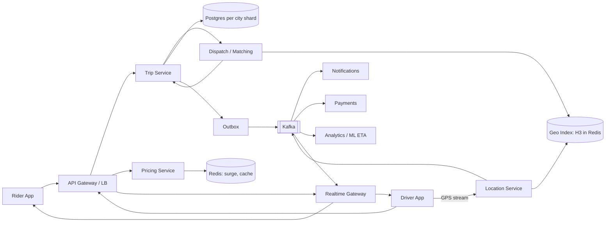
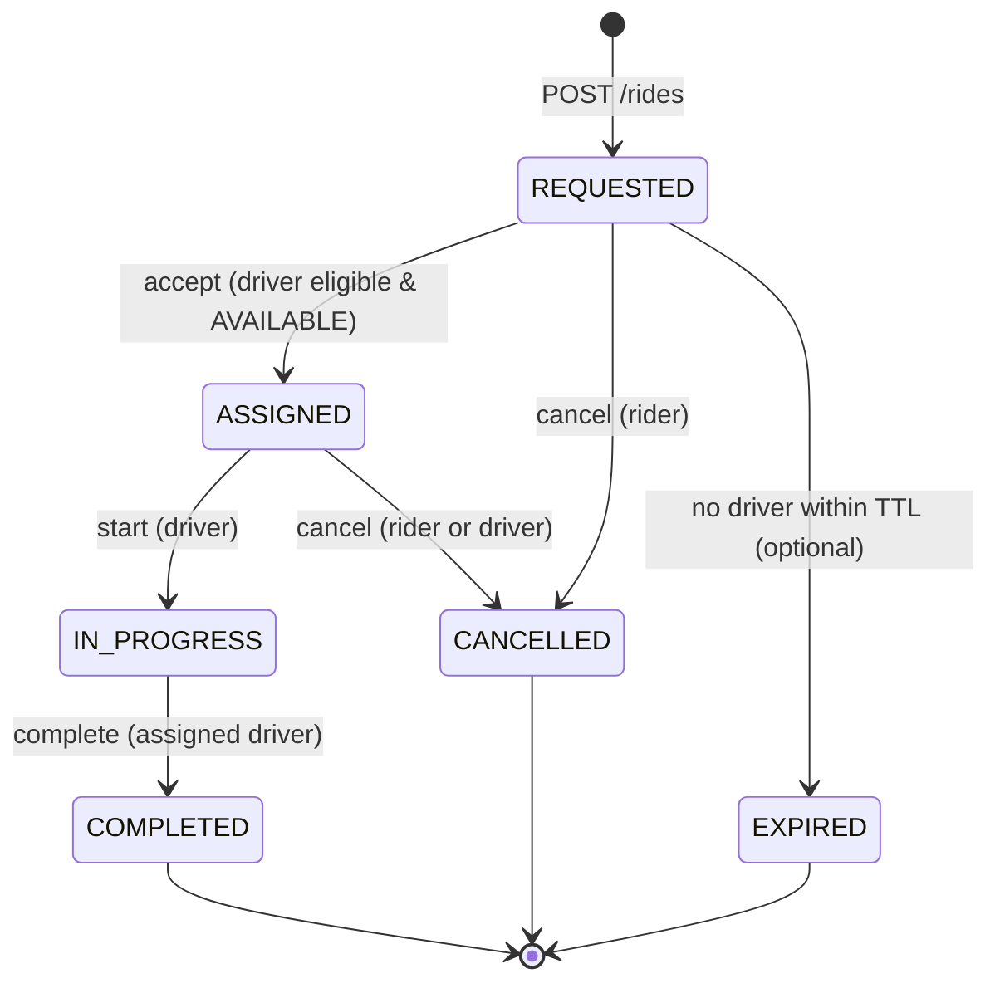
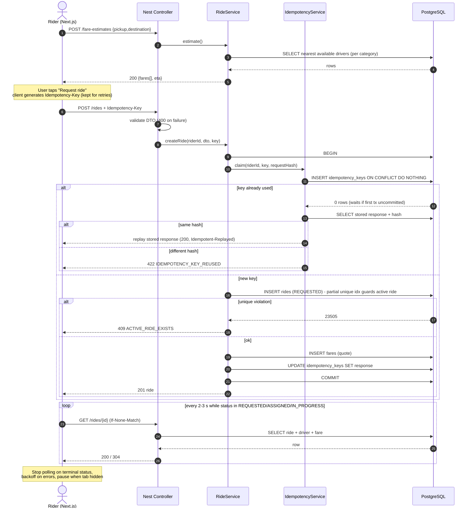

# Ride-Booking Assessment: Engineering Blueprint

Stack: Next.js (App Router, TS) · Nest.js (Node LTS, TS) · PostgreSQL · Docker Compose
Budget: 6–8 hours. Priorities: correctness, clarity, judgment over feature count.

---

# Step 1: Requirement Simplification & Stack Adaptation

## 1.1 What the assessment asks, in plain terms

Build a small Uber-like app for Lahore where:

1. **A rider** picks pickup + destination, chooses Economy or Comfort, sees an estimated fare and pickup ETA, requests a ride, watches its status, and can cancel while allowed.
2. **A backend** stores riders, drivers (with availability), rides, driver assignments and fares in PostgreSQL, and exposes `POST /rides`, `GET /rides/{id}`, `POST /rides/{id}/accept`, `/cancel`, `/complete`.
3. **Correctness under concurrency** is the real test:
   - two drivers must never both win the same ride;
   - simultaneous requests are safe;
   - retries and double-clicks do not create duplicate rides;
   - illegal state transitions (e.g. complete a cancelled ride) are rejected.
4. **Engineering hygiene**: validation, consistent errors, transactions, tests (incl. concurrency and one E2E), env config with no secrets in git, Docker/reproducible setup, OpenAPI, logging.
5. **Written deliverables**: README, schema/migrations, architecture doc answering 8 questions (+ diagram), known limitations, AI-tool disclosure.
6. A follow-up interview will probe your decisions, so every choice must be explainable in one or two sentences.

Explicit non-goals: real maps, payments, real geo-matching, a complete product.

## 1.2 "Ideal" technology if there were no constraints

| Layer | Ideal choice | Why |
|---|---|---|
| Rider/driver apps | React Native or native + Next.js web | Mobile-first product |
| Realtime | WebSockets / gRPC streaming, MQTT for driver GPS | Low-latency location + status push |
| API edge | API gateway + Envoy/NGINX | Auth, rate-limit, routing |
| Core services | Go or Java/Kotlin (matching, trips), Node for BFF | Throughput, predictable latency |
| Geo index | H3 or S2 cells in Redis / in-memory shards; PostGIS for durable geo | Sub-ms nearby-driver lookup |
| Primary DB | PostgreSQL (+PostGIS), sharded/partitioned per city | ACID for trips and payments |
| Cache / ephemeral | Redis (driver presence, locks, rate limits) | Fast, TTL-based |
| Messaging | Kafka (events, location stream) | Decoupling, replay |
| Search/analytics | ClickHouse / BigQuery | Trip analytics |
| Observability | OpenTelemetry, Prometheus, Grafana, Loki, Sentry | Full visibility |
| Infra | Kubernetes, Terraform, ArgoCD, multi-AZ | Scaling, safe rollouts |

## 1.3 Adapted stack (locked)

| Concern | Choice |
|---|---|
| Frontend | **Next.js (latest, App Router) + TypeScript**, Tailwind, TanStack Query, react-hook-form + zod |
| Backend | **Nest.js (latest, Node LTS) + TypeScript**, `pg` driver, `node-pg-migrate` SQL migrations, `class-validator`/`zod`, `@nestjs/swagger`, `nestjs-pino`, `@nestjs/throttler`, `helmet` |
| Database | **PostgreSQL 16** (no Redis, no broker) |
| Tests | Jest + Supertest (backend, against real Postgres), Vitest + React Testing Library + MSW (frontend), Playwright (E2E) |
| Local/ops | Docker Compose (postgres, backend, frontend), GitHub Actions CI |

**Why this works for this assessment**

- **One language end to end.** Shared types and zod schemas (a small `packages/contracts` or copied OpenAPI-generated types) remove a whole class of contract bugs and save hours.
- **Nest gives structure for free**: modules, DI, guards, pipes, filters, interceptors map directly onto the rubric ("separation of frontend, business logic, API handlers, persistence"). DI also makes services unit-testable with fakes.
- **Postgres alone solves the core problem.** Row locks and conditional updates give exactly-once assignment without distributed locks.
- **Next.js** supplies routing, SSR-safe structure, and an easy Playwright story; TanStack Query gives polling, retries, and loading/error states with little code.
- **Raw SQL repositories** (instead of a heavy ORM) keep locking semantics explicit and explainable in the interview.

---

# Step 2: Macro System Design (Uber at Scale)

## 2.1 Core ideas

- **Geo-spatial indexing**: Partition the world into hex cells (H3, resolution ~8–9). Each driver's latest position lives in an in-memory/Redis structure keyed by cell. Nearby search = query the rider's cell + k-ring neighbors, then refine by real road ETA. Alternative: Redis `GEOSEARCH`, or PostGIS `ST_DWithin` + GiST index for durable/smaller scale.
- **Location ingestion**: Drivers stream GPS every 3–5 s over WebSocket/MQTT to a Location Service, which writes to the geo index (TTL ≈ 30 s for presence) and publishes to Kafka for analytics/ETA models. Never write each ping to the primary OLTP DB.
- **Dispatch/Matching service**: On a ride request, query candidates, rank (ETA, rating, acceptance rate), send *offers* sequentially or in small batches with a timeout (~10–15 s). The first accept wins via an atomic state transition; the others receive "offer expired".
- **Trip service**: Owns the ride state machine in Postgres (source of truth). Emits domain events (`ride.requested`, `ride.assigned`, …) via the transactional-outbox pattern to Kafka.
- **Message broker (Kafka)**: Decouples trip events from notifications, pricing, fraud, analytics, payments. Enables replay and independent consumers.
- **Caching (Redis)**: Driver presence, surge multipliers per cell, idempotency fast-path, rate limits, short-lived offer locks.
- **Realtime delivery**: WebSocket gateway (stateless, sticky-less, fan-out via Redis pub/sub or Kafka) pushes status to riders/drivers; SSE/polling as fallback.
- **Load balancing**: Global DNS/GeoDNS → regional L7 LB (NGINX/Envoy/ALB) → stateless services behind autoscaling; WebSocket gateway tier scaled by connection count.
- **Microservices**: Rider/Driver identity, Location, Dispatch, Trip, Pricing, Payments, Notifications, Maps/ETA. Split along ownership and scaling profile, not by default.
- **Data scaling**: Shard/partition by `city_id` (cities are naturally isolated); read replicas for history; archive completed trips to cold storage.
- **Resilience**: Circuit breakers, timeouts, retries with jitter, idempotency keys everywhere, graceful degradation (e.g. fall back to flat fare if the pricing service is down).



---

# Step 3: Assessment-Specific System Design

## 3.1 Principles

- One deployable backend (modular monolith), one Postgres. **No Redis, no Kafka**: not needed for the stated constraints; I explain in the architecture doc when they would be introduced.
- **Postgres is the single arbiter of truth.** Concurrency is solved with (a) row-level locks (`SELECT … FOR UPDATE`), (b) conditional updates (`WHERE status = 'REQUESTED'`), and (c) partial unique indexes as a last line of defence.
- Matching is **pull/offer-based and simplified**: a ride sits in `REQUESTED`; any eligible, available driver may call `accept`. A tiny Driver Console page in the frontend (and seed drivers) lets reviewers exercise the whole flow. Geographic ranking is simplified to a Haversine distance computed in SQL/TS.

## 3.2 Ride state machine



Rules:
- Terminal states (`COMPLETED`, `CANCELLED`, `EXPIRED`) never change.
- Cancel is **not** allowed once `IN_PROGRESS` (UI hides the button; API returns `409`).
- The transition table lives in one pure function (`canTransition(from, to)`) with unit tests; services call it, SQL re-enforces it with `WHERE status = ...`.
- I add `POST /rides/{id}/start` because `complete` should require `IN_PROGRESS`. (Documented assumption; if the reviewer expects accept→complete directly, `start` can be auto-applied.)

## 3.3 Concurrency mechanisms

### A. Exactly one driver wins a ride

Single transaction, **READ COMMITTED** (sufficient because we lock rows explicitly):

```sql
BEGIN;
-- 1. Lock ride row. Concurrent accepters/cancellers queue here.
SELECT * FROM rides WHERE id = $ride FOR UPDATE;
--    status must be 'REQUESTED' else 409 (or idempotent 200 if same driver already assigned)

-- 2. Lock driver row (fixed lock order: ride -> driver, avoids deadlocks)
SELECT * FROM drivers WHERE id = $driver FOR UPDATE;
--    must be AVAILABLE and category-eligible

-- 3. Conditional writes (belt and braces)
UPDATE rides SET status='ASSIGNED', driver_id=$driver, assigned_at=now(),
                 version=version+1, updated_at=now()
 WHERE id=$ride AND status='REQUESTED';          -- expect rowCount = 1
UPDATE drivers SET availability='BUSY', updated_at=now()
 WHERE id=$driver AND availability='AVAILABLE';  -- expect rowCount = 1
INSERT INTO ride_assignments (ride_id, driver_id, status) VALUES ($ride,$driver,'ACTIVE');
COMMIT;
```

Why it is safe:
1. `FOR UPDATE` serialises everyone touching that ride. The second transaction blocks, then re-reads the *committed* row, sees `ASSIGNED`, and returns `409 RIDE_ALREADY_ASSIGNED`.
2. The conditional `UPDATE … WHERE status='REQUESTED'` makes the transition a compare-and-swap even if someone removes the lock later.
3. **Partial unique indexes** are a DB-level backstop: at most one `ACTIVE` assignment per ride and per driver.
4. A driver cannot accept two rides at once: the driver row lock + `availability` check + unique index on active assignments per driver.
5. Cancel/complete take the **same lock order** (ride, then driver), so accept-vs-cancel races resolve deterministically, with no deadlocks.

Alternative considered: `SERIALIZABLE` isolation with retry on `40001`. It works but needs retry loops and is harder to explain; explicit locks are simpler and cheaper here. `SELECT … FOR UPDATE SKIP LOCKED` is the right tool for a *queue of rides* consumed by a dispatcher, noted for the production section.

### B. Simultaneous / duplicate ride requests

- **Idempotency-Key header** (UUID from the client, generated once per "Request ride" intent, reused on retries).
- `idempotency_keys` table with `UNIQUE (rider_id, key)`, stores `request_hash` and the final response.
- Flow inside one transaction: `INSERT … ON CONFLICT DO NOTHING`. A concurrent duplicate blocks on the unique index until the first commits, then reads the stored response and replays it (`Idempotent-Replayed: true`). Same key + different body → `422 IDEMPOTENCY_KEY_REUSED`.
- Business-level duplicate guard: partial unique index `one_active_ride_per_rider` on `rides(rider_id) WHERE status IN ('REQUESTED','ASSIGNED','IN_PROGRESS')`. A *new* intent while a ride is active returns `409 ACTIVE_RIDE_EXISTS` (with the active ride id) even without a key.

### C. State-transition safety

All transitions go through `RideStateMachine` + locked read + conditional update. Invalid → `409 INVALID_STATE_TRANSITION` with `{ currentStatus, attempted }`.

### D. Idempotent lifecycle calls

- Accept by the same driver on an already-assigned-to-them ride → `200` (replay).
- Cancel on already-cancelled → `200` with the same body (idempotent), cancel on completed → `409`.
- Complete on already-completed → `200` replay.

## 3.4 Matching and fare (simplified)

- **Eligibility**: driver `AVAILABLE`, fresh location (`location_updated_at` within 2 min), `vehicle_category` ≥ ride category (Comfort cars may take Economy; Economy cars cannot take Comfort).
- **Candidate listing for drivers**: `GET /drivers/{id}/offers` returns `REQUESTED` rides compatible with the driver, ordered by Haversine distance to the pickup, limited to 5 km (config).
- **ETA**: nearest eligible driver's Haversine distance × 1.3 road factor ÷ 25 km/h (+ 1 min buffer). If none, `etaMinutes: null` → UI shows "No drivers nearby" empty state and disables request (configurable).
- **Fare** (PKR, integer rupees): `max(minFare, base + perKm·km + perMin·min) × surge(1.0)`. Config per category (Economy: base 150, 40/km, 5/min, min 250; Comfort: base 250, 65/km, 8/min, min 400). Distance = Haversine × 1.3; duration = distance ÷ 24 km/h. The quote is persisted in `fares` at ride creation so what the rider saw is what is stored.
- **Production nearby discovery** (documented only): H3 cell index or PostGIS GiST + `ST_DWithin`, driver presence in Redis with TTL, road-network ETA from a routing engine (OSRM/Valhalla/Google).

## 3.5 Architecture diagram

```mermaid
flowchart TB
  subgraph Browser
    UI[Next.js UI<br/>Rider page + Driver console]
    TQ[TanStack Query<br/>polling / retry / cache]
    UI --> TQ
  end

  subgraph Backend[Nest.js backend - modular monolith]
    MW[Middleware: requestId, helmet, throttler, pino]
    VAL[Validation pipes / DTOs]
    CTL[Controllers: Rides, Drivers, Fares, Health]
    SVC[Services: RideService, MatchingService, FareService, IdempotencyService]
    SM[RideStateMachine - pure]
    REPO[Repositories - raw SQL via pg]
    TX[TransactionManager - BEGIN/COMMIT/ROLLBACK, lock helpers]
    FLT[Global exception filter - consistent errors]
    MW --> VAL --> CTL --> SVC
    SVC --> SM
    SVC --> REPO --> TX
    CTL -.errors.-> FLT
  end

  subgraph Postgres[(PostgreSQL)]
    T1[riders]
    T2[drivers]
    T3[rides]
    T4[ride_assignments]
    T5[fares]
    T6[idempotency_keys]
  end

  TQ -- REST/JSON + Idempotency-Key --> MW
  TX --> Postgres
  OPENAPI[Swagger /docs] -.generated from.-> CTL
```

---

# Step 4: API Design & Sequence Diagrams

## 4.1 Conventions

- Base path `/api/v1`. JSON only. Timestamps ISO-8601 UTC. Money = integer PKR (`currency: "PKR"`).
- **Auth (simplified, documented limitation):** caller identity via headers `X-Rider-Id` / `X-Driver-Id` (UUIDs of seeded users), validated by a guard that checks the user exists. Production: JWT/OIDC. The guard is isolated so swapping it is a one-file change.
- Every response carries `X-Request-Id`.
- **Error envelope (all non-2xx):**
```json
{
  "error": {
    "code": "INVALID_STATE_TRANSITION",
    "message": "Ride cannot move from CANCELLED to COMPLETED",
    "details": { "currentStatus": "CANCELLED", "attempted": "COMPLETED" },
    "requestId": "b1f4…"
  }
}
```
- Error codes: `VALIDATION_ERROR` 400, `UNAUTHENTICATED` 401, `FORBIDDEN` 403, `NOT_FOUND` 404, `RIDE_ALREADY_ASSIGNED` 409, `INVALID_STATE_TRANSITION` 409, `ACTIVE_RIDE_EXISTS` 409, `DRIVER_UNAVAILABLE` 409, `DRIVER_NOT_ELIGIBLE` 403, `IDEMPOTENCY_KEY_REUSED` 422, `RATE_LIMITED` 429, `INTERNAL_ERROR` 500.

## 4.2 Shared validation rules

- `lat` ∈ [-90, 90], `lng` ∈ [-180, 180]; additionally within Lahore service bounding box (config, e.g. lat 31.35–31.70, lng 74.10–74.55) else `VALIDATION_ERROR` with `OUT_OF_SERVICE_AREA`.
- `pickup` and `destination` must differ by ≥ 200 m.
- `name` string 1–120 chars, trimmed. `category` ∈ `ECONOMY | COMFORT`.
- Unknown properties rejected (`forbidNonWhitelisted`). IDs must be UUID v4.

## 4.3 Endpoints

### `POST /rides`: create ride request
Headers: `X-Rider-Id`, `Idempotency-Key` (required, UUID).
Request:
```json
{
  "pickup":      { "name": "Liberty Market", "lat": 31.5106, "lng": 74.3440 },
  "destination": { "name": "Lahore Fort",    "lat": 31.5889, "lng": 74.3149 },
  "category": "ECONOMY"
}
```
Responses:
- `201 Created`:
```json
{
  "id": "…", "status": "REQUESTED", "category": "ECONOMY",
  "pickup": {…}, "destination": {…},
  "fare": { "currency": "PKR", "estimatedTotal": 640,
            "breakdown": { "base": 150, "distance": 360, "time": 130, "surge": 1.0 } },
  "etaMinutes": 4, "driver": null,
  "createdAt": "…", "updatedAt": "…", "version": 1
}
```
- `200 OK` + `Idempotent-Replayed: true` on a replayed key.
- `400` validation · `401` missing rider · `409 ACTIVE_RIDE_EXISTS` · `422 IDEMPOTENCY_KEY_REUSED` · `429`.

### `GET /rides/{id}`: ride details
Headers: `X-Rider-Id` or `X-Driver-Id` (must be the ride's rider or assigned driver; drivers may view `REQUESTED` rides that appear in their offers).
- `200` ride object (above; `driver` populated when assigned: `{id, name, vehicle, plate, location}`; `finalFare` when completed).
- `404` not found/not visible (do not leak existence) · `400` bad UUID.
- Supports `ETag`/`If-None-Match` → `304` to make polling cheap.

### `POST /rides/{id}/accept`: driver accepts
Headers: `X-Driver-Id`. Body: none.
- `200` ride with `status: "ASSIGNED"`, `driver`, `assignedAt`.
- `404` · `403 DRIVER_NOT_ELIGIBLE` · `409 RIDE_ALREADY_ASSIGNED` (someone else won) · `409 DRIVER_UNAVAILABLE` (BUSY/OFFLINE) · `409 INVALID_STATE_TRANSITION` (cancelled/completed).
- Idempotent for same driver (returns 200).

### `POST /rides/{id}/start`: driver starts trip (added)
Headers: `X-Driver-Id` (must be assigned driver). `200` `IN_PROGRESS`; `403`; `409 INVALID_STATE_TRANSITION`.

### `POST /rides/{id}/cancel`
Headers: `X-Rider-Id` or `X-Driver-Id`. Body (optional): `{ "reason": "string ≤ 255" }`.
- Allowed from `REQUESTED` (rider) and `ASSIGNED` (rider or assigned driver). Frees the driver (`AVAILABLE`), closes assignment as `CANCELLED`.
- `200` ride `CANCELLED` (`cancelledBy`, `cancelReason`) · `403` · `404` · `409 INVALID_STATE_TRANSITION` (`IN_PROGRESS`/`COMPLETED`).
- Already cancelled → `200` (idempotent).

### `POST /rides/{id}/complete`
Headers: `X-Driver-Id` (assigned driver). Body: none (final fare = estimate in this scope).
- `200` ride `COMPLETED` with `finalFare`, `completedAt`. Frees driver, closes assignment `COMPLETED`.
- `403` · `404` · `409 INVALID_STATE_TRANSITION` (must be `IN_PROGRESS`).

### Supporting endpoints
| Method | Path | Purpose |
|---|---|---|
| POST | `/fare-estimates` | `{pickup, destination}` → both categories' fare + ETA (powers the pre-request UI without creating a ride) |
| GET | `/drivers/{id}/offers` | Compatible `REQUESTED` rides near the driver |
| PATCH | `/drivers/{id}/availability` | `{status: AVAILABLE|OFFLINE, lat, lng}` (cannot set while `BUSY`) |
| GET | `/riders/me/active-ride` | Restore UI after refresh |
| GET | `/health/live`, `/health/ready` | Liveness / DB readiness |
| GET | `/docs`, `/docs-json` | Swagger UI / OpenAPI |

## 4.4 Sequence: ride creation and status polling



## 4.5 Sequence: driver acceptance with concurrency control

```mermaid
sequenceDiagram
  autonumber
  actor D1 as Driver A
  actor D2 as Driver B
  participant API as Nest API
  participant S as RideService
  participant DB as PostgreSQL

  par Driver A
    D1->>API: POST /rides/{id}/accept (X-Driver-Id: A)
    API->>S: accept(rideId, A)
    S->>DB: BEGIN
    S->>DB: SELECT ride FOR UPDATE
    Note right of DB: A acquires row lock on ride
  and Driver B
    D2->>API: POST /rides/{id}/accept (X-Driver-Id: B)
    API->>S: accept(rideId, B)
    S->>DB: BEGIN
    S->>DB: SELECT ride FOR UPDATE
    Note right of DB: B BLOCKS waiting for A
  end

  S->>DB: (A) status==REQUESTED? yes
  S->>DB: (A) SELECT driver A FOR UPDATE (AVAILABLE, eligible)
  S->>DB: (A) UPDATE rides SET ASSIGNED WHERE status='REQUESTED' (1 row)
  S->>DB: (A) UPDATE drivers SET BUSY WHERE availability='AVAILABLE' (1 row)
  S->>DB: (A) INSERT ride_assignments ACTIVE
  S->>DB: (A) COMMIT (lock released)
  S-->>D1: 200 ASSIGNED

  DB-->>S: (B) lock granted, re-reads COMMITTED row: status=ASSIGNED
  S->>DB: (B) ROLLBACK
  S-->>D2: 409 RIDE_ALREADY_ASSIGNED

  Note over DB: Backstops: partial unique indexes on active assignment per ride and per driver; invalid transition -> 409 INVALID_STATE_TRANSITION
```

---

# Step 5: Agentic Spec-Driven Development Blueprint

> Paste sections below into Cursor as a single spec (or as `SPEC.md` + rules). Implement in the order given; after each phase run the listed checks before moving on.

## 5.0 Global rules for the agent

- Workspace: `/frontend` (Next.js), `/backend` (Nest.js), root `docker-compose.yml`, `README.md`, `docs/ARCHITECTURE.md`, `.env.example` files. **Never commit `.env` or secrets**; provide `.env.example` with dummy values only; `.gitignore` covers `.env*` (except examples), `node_modules`, `dist`, `.next`, `coverage`, `playwright-report`.
- TypeScript `strict: true`. ESLint + Prettier. No `any` without a comment.
- Business logic lives only in services/state machine, never in controllers or SQL strings scattered around. SQL lives only in repositories.
- All state changes happen inside a transaction via `TransactionManager.run(fn)`.
- Every endpoint documented with `@nestjs/swagger` decorators; the OpenAPI JSON is exported to `backend/openapi.json` by a script (`npm run openapi:export`).
- Commit in small, meaningful steps (schema → domain → API → tests → frontend → E2E → docs).

## 5.1 Repository layout

```
/
├─ docker-compose.yml
├─ README.md
├─ docs/ARCHITECTURE.md   (8 questions + diagrams + limitations + AI disclosure)
├─ .github/workflows/ci.yml
├─ backend/
│  ├─ Dockerfile
│  ├─ .env.example
│  ├─ migrations/        (node-pg-migrate, *.sql up/down)
│  ├─ src/
│  │  ├─ main.ts, app.module.ts
│  │  ├─ config/         (env.schema.ts - zod; config.module.ts)
│  │  ├─ common/         (filters, guards, interceptors, errors, decorators, utils/geo.ts)
│  │  ├─ database/       (database.module.ts, transaction-manager.ts, pg-pool.provider.ts)
│  │  ├─ rides/          (rides.controller.ts, rides.service.ts, ride-state-machine.ts,
│  │  │                   rides.repository.ts, dto/, rides.module.ts)
│  │  ├─ drivers/        (drivers.controller.ts, drivers.service.ts, drivers.repository.ts)
│  │  ├─ riders/         (riders.repository.ts)
│  │  ├─ fares/          (fare.service.ts, fares.repository.ts, fare.config.ts)
│  │  ├─ matching/       (matching.service.ts)
│  │  ├─ idempotency/    (idempotency.service.ts, idempotency.repository.ts)
│  │  ├─ health/         (health.controller.ts)
│  │  └─ seed/           (seed.ts)
│  └─ test/              (integration + e2e api tests, helpers/test-db.ts)
└─ frontend/
   ├─ Dockerfile, .env.example
   ├─ src/app/           (layout.tsx, page.tsx rider, driver/page.tsx, ride/[id]/page.tsx)
   ├─ src/components/    (BookingForm, LocationPicker, CategorySelector, FareCard, RideStatus,
   │                      MapPlaceholder, ErrorBanner, EmptyState, Skeletons, DriverConsole)
   ├─ src/lib/           (api-client.ts, idempotency.ts, landmarks.ts, query-client.ts, errors.ts)
   ├─ src/hooks/         (useFareEstimate, useCreateRide, useRide, useCancelRide, useActiveRide)
   ├─ src/types/         (api.ts, generated or hand-written to match OpenAPI)
   ├─ tests/             (unit/component: Vitest; e2e: Playwright)
   └─ playwright.config.ts
```

## 5.2 Database schema & migrations

Use `node-pg-migrate` with SQL migrations (`npm run migrate:up|down`). Enable `pgcrypto` for `gen_random_uuid()`. Prefer `CHECK` constraints + enums as text with checks (easier to migrate).

**Migration 001: init**

```sql
CREATE EXTENSION IF NOT EXISTS pgcrypto;

CREATE TABLE riders (
  id          uuid PRIMARY KEY DEFAULT gen_random_uuid(),
  name        varchar(120) NOT NULL,
  phone       varchar(20)  NOT NULL UNIQUE,
  created_at  timestamptz  NOT NULL DEFAULT now()
);

CREATE TABLE drivers (
  id                   uuid PRIMARY KEY DEFAULT gen_random_uuid(),
  name                 varchar(120) NOT NULL,
  phone                varchar(20)  NOT NULL UNIQUE,
  vehicle_category     text NOT NULL CHECK (vehicle_category IN ('ECONOMY','COMFORT')),
  vehicle_model        varchar(80)  NOT NULL,
  vehicle_plate        varchar(20)  NOT NULL UNIQUE,
  availability         text NOT NULL DEFAULT 'OFFLINE'
                         CHECK (availability IN ('OFFLINE','AVAILABLE','BUSY')),
  lat                  double precision CHECK (lat BETWEEN -90 AND 90),
  lng                  double precision CHECK (lng BETWEEN -180 AND 180),
  location_updated_at  timestamptz,
  created_at           timestamptz NOT NULL DEFAULT now(),
  updated_at           timestamptz NOT NULL DEFAULT now()
);
CREATE INDEX idx_drivers_available ON drivers (vehicle_category, availability)
  WHERE availability = 'AVAILABLE';

CREATE TABLE rides (
  id               uuid PRIMARY KEY DEFAULT gen_random_uuid(),
  rider_id         uuid NOT NULL REFERENCES riders(id),
  driver_id        uuid REFERENCES drivers(id),
  category         text NOT NULL CHECK (category IN ('ECONOMY','COMFORT')),
  status           text NOT NULL DEFAULT 'REQUESTED'
                     CHECK (status IN ('REQUESTED','ASSIGNED','IN_PROGRESS','COMPLETED','CANCELLED','EXPIRED')),
  pickup_name      varchar(160) NOT NULL,
  pickup_lat       double precision NOT NULL,
  pickup_lng       double precision NOT NULL,
  dest_name        varchar(160) NOT NULL,
  dest_lat         double precision NOT NULL,
  dest_lng         double precision NOT NULL,
  distance_m       integer NOT NULL CHECK (distance_m > 0),
  duration_s       integer NOT NULL CHECK (duration_s > 0),
  eta_minutes      integer,
  cancelled_by     text CHECK (cancelled_by IN ('RIDER','DRIVER','SYSTEM')),
  cancel_reason    varchar(255),
  version          integer NOT NULL DEFAULT 1,
  requested_at     timestamptz NOT NULL DEFAULT now(),
  assigned_at      timestamptz,
  started_at       timestamptz,
  completed_at     timestamptz,
  cancelled_at     timestamptz,
  updated_at       timestamptz NOT NULL DEFAULT now(),
  CONSTRAINT chk_driver_consistency CHECK (
    (status = 'REQUESTED' AND driver_id IS NULL) OR
    (status IN ('ASSIGNED','IN_PROGRESS','COMPLETED') AND driver_id IS NOT NULL) OR
    (status IN ('CANCELLED','EXPIRED'))
  )
);
CREATE INDEX idx_rides_rider ON rides (rider_id, requested_at DESC);
CREATE INDEX idx_rides_open ON rides (category, requested_at) WHERE status = 'REQUESTED';
-- one active ride per rider (duplicate-request backstop)
CREATE UNIQUE INDEX uq_one_active_ride_per_rider ON rides (rider_id)
  WHERE status IN ('REQUESTED','ASSIGNED','IN_PROGRESS');

CREATE TABLE ride_assignments (
  id          uuid PRIMARY KEY DEFAULT gen_random_uuid(),
  ride_id     uuid NOT NULL REFERENCES rides(id),
  driver_id   uuid NOT NULL REFERENCES drivers(id),
  status      text NOT NULL DEFAULT 'ACTIVE' CHECK (status IN ('ACTIVE','COMPLETED','CANCELLED')),
  assigned_at timestamptz NOT NULL DEFAULT now(),
  ended_at    timestamptz
);
-- the hard guarantees: one active driver per ride, one active ride per driver
CREATE UNIQUE INDEX uq_active_assignment_per_ride   ON ride_assignments (ride_id)   WHERE status = 'ACTIVE';
CREATE UNIQUE INDEX uq_active_assignment_per_driver ON ride_assignments (driver_id) WHERE status = 'ACTIVE';

CREATE TABLE fares (
  id               uuid PRIMARY KEY DEFAULT gen_random_uuid(),
  ride_id          uuid NOT NULL UNIQUE REFERENCES rides(id),
  currency         char(3) NOT NULL DEFAULT 'PKR',
  base_amount      integer NOT NULL CHECK (base_amount >= 0),
  distance_amount  integer NOT NULL CHECK (distance_amount >= 0),
  time_amount      integer NOT NULL CHECK (time_amount >= 0),
  surge_multiplier numeric(4,2) NOT NULL DEFAULT 1.00 CHECK (surge_multiplier >= 1),
  estimated_total  integer NOT NULL CHECK (estimated_total >= 0),
  final_total      integer CHECK (final_total >= 0),
  created_at       timestamptz NOT NULL DEFAULT now()
);

CREATE TABLE idempotency_keys (
  id               uuid PRIMARY KEY DEFAULT gen_random_uuid(),
  rider_id         uuid NOT NULL REFERENCES riders(id),
  key              uuid NOT NULL,
  request_hash     char(64) NOT NULL,
  response_status  integer,
  response_body    jsonb,
  ride_id          uuid REFERENCES rides(id),
  created_at       timestamptz NOT NULL DEFAULT now(),
  UNIQUE (rider_id, key)
);
```

Down migration drops in reverse dependency order. **Seed script** (`npm run seed`, idempotent via `ON CONFLICT DO NOTHING`): 3 riders, 6 drivers (4 Economy, 2 Comfort) with locations around Gulberg, DHA, Model Town, Johar Town, Walled City; `AVAILABLE` for most. Seeds contain only fake data.

## 5.3 Backend implementation spec

### 5.3.1 Config & bootstrap
- `env.schema.ts` (zod) validates at startup and **fails fast**: `NODE_ENV`, `PORT`, `DATABASE_URL`, `DB_POOL_MAX` (default 10), `LOG_LEVEL`, `CORS_ORIGINS`, `SERVICE_AREA_BBOX`, `MAX_OFFER_RADIUS_KM`, `DRIVER_LOCATION_TTL_SECONDS`, `RATE_LIMIT_TTL/LIMIT`, fare params (or fare.config.ts defaults).
- `main.ts`: `helmet()`, CORS allow-list, global prefix `/api/v1`, `ValidationPipe({ whitelist, forbidNonWhitelisted, transform })`, global `AllExceptionsFilter`, Swagger at `/docs`, graceful shutdown (`enableShutdownHooks`, close pool).
- Request-id middleware (`x-request-id` in/out), `nestjs-pino` with request-id, redacts `authorization`, `cookie`; JSON logs in prod, pretty in dev. Log state transitions at `info` (`ride.assigned`, rideId, driverId), expected conflicts at `warn`, unexpected errors at `error` with stack (never in response).

### 5.3.2 Database layer
- `PgPoolProvider` (singleton `Pool`). `TransactionManager.run<T>(fn: (tx: TxClient) => Promise<T>)`: acquire client, `BEGIN`, run, `COMMIT`, on error `ROLLBACK`, always `release()`. Uses `AsyncLocalStorage` *or* explicit `tx` parameter passed to repositories (prefer explicit: simpler to reason about).
- Repositories accept `Queryable` (pool or tx client). Methods (rides): `insert`, `findByIdForUpdate`, `findByIdWithDetails`, `markAssigned`, `markStarted`, `markCompleted`, `markCancelled` (each with `WHERE status = $expected` and returns row count), `findOpenOffersNear`. Drivers: `findByIdForUpdate`, `setAvailability` (conditional), `findNearestAvailable(category, lat, lng, limit)`, `updateLocation`.
- Haversine in SQL (no PostGIS needed) with a bounding-box prefilter, or compute in TS for small data; keep in `common/utils/geo.ts` with unit tests.

### 5.3.3 Domain
- `ride-state-machine.ts`: pure `TRANSITIONS` map, `assertTransition(from, to, actor)` throws `InvalidStateTransitionError` (maps to 409). Actor rules: only rider cancels `REQUESTED`; rider or assigned driver cancels `ASSIGNED`; only assigned driver starts/completes.
- `FareService.quote(pickup, dest, category)` → `{distanceM, durationS, breakdown, total}`; pure and unit-tested. Rounds to whole PKR; applies `minFare`.
- `MatchingService.estimateEta(category, pickup)` and `listOffers(driverId)`.
- Domain errors (`DomainError` base with `code`, `httpStatus`, `details`): `RideNotFound`, `RideAlreadyAssigned`, `InvalidStateTransition`, `DriverUnavailable`, `DriverNotEligible`, `ActiveRideExists`, `IdempotencyKeyReused`. `AllExceptionsFilter` maps `DomainError`, `HttpException`, validation errors (flatten to `details.fields`), Postgres `23505`/`40001`/`57014` and unknown → standard envelope; unknown → `500 INTERNAL_ERROR` without internals.

### 5.3.4 Service flows (must match Step 3 SQL)
- `createRide`: validate area/distance → compute quote and ETA (outside tx) → `tx.run`: `idempotency.claim` → insert ride → insert fare → `idempotency.complete(response)`. Catch `23505` on `uq_one_active_ride_per_rider` → `ActiveRideExists`.
- `accept`, `start`, `cancel`, `complete`: each `tx.run` with **lock order ride → driver**, then `assertTransition`, then conditional update (assert rowCount = 1, else throw conflict), update driver availability, update assignment, bump `version`, return full ride DTO.
- Cancel and complete free the driver (`AVAILABLE`) and end the active assignment; complete writes `fares.final_total`.
- Idempotent replays as defined in Step 3.3D.
- Optional: `ExpirySweeper` (`@nestjs/schedule` every 30 s) marks `REQUESTED` rides older than `RIDE_REQUEST_TTL_SECONDS` as `EXPIRED` using `UPDATE … WHERE status='REQUESTED' AND requested_at < now() - interval` (safe without locks because it is a conditional update). Skip if time is short; list under limitations.

### 5.3.5 Controllers & DTOs
- DTOs with `class-validator` + `class-transformer`: `LocationDto`, `CreateRideDto`, `CancelRideDto`, `FareEstimateDto`, `UpdateAvailabilityDto`. Response DTOs with `@ApiProperty`. `ParseUUIDPipe` on `:id`.
- `ActorGuard` + `@CurrentRider()` / `@CurrentDriver()` decorators reading `X-Rider-Id` / `X-Driver-Id`; verify existence in DB; `401` if missing, `403` if wrong role/ownership.
- `@Throttle` stricter on `POST /rides` (e.g. 10/min/rider).

### 5.3.6 Docker/ops
- `backend/Dockerfile` multi-stage (build → `node:lts-slim`, non-root user, `HEALTHCHECK` on `/api/v1/health/live`).
- `docker-compose.yml`: `postgres:16` (healthcheck `pg_isready`, volume), `backend` (depends_on healthy, runs `migrate:up` then `start:prod`), `frontend`. Credentials via `.env` (compose `env_file`), with `.env.example` values like `POSTGRES_PASSWORD=change_me`.
- `README` must include: prerequisites, `cp .env.example .env`, `docker compose up --build`, seed command, URLs, how to run each test suite, sample `curl` requests, OpenAPI location.

## 5.4 Frontend implementation spec

### 5.4.1 Foundations
- Next.js App Router, TS strict, Tailwind. `NEXT_PUBLIC_API_BASE_URL` (non-secret). Providers: TanStack `QueryClientProvider`.
- `api-client.ts`: typed `fetch` wrapper that (1) attaches `X-Rider-Id`/`X-Driver-Id` from a demo "Switch user" selector (stored in `localStorage`; seeded IDs from env), (2) attaches `Idempotency-Key` for `POST /rides`, (3) parses the standard error envelope into an `ApiError { code, message, status, requestId, details }`, (4) handles network failure/timeouts (`AbortController`, 10 s) as `NETWORK_ERROR`.
- `lib/landmarks.ts`: ~12 Lahore landmarks with coordinates (Liberty Market, Lahore Fort, Badshahi Mosque, Gaddafi Stadium, Emporium Mall, Packages Mall, Allama Iqbal Airport, Lahore Railway Station, Johar Town, DHA Phase 5, Model Town, Mall Road). Pickup/destination use a searchable combobox of these (avoids geocoding; documented as a simplification).

### 5.4.2 Rider page (`/`)
State machine in UI (derive from data, not scattered booleans): `idle → estimating → ready → requesting → active(ride) → terminal`.
- **BookingForm** (react-hook-form + zod): pickup, destination (must differ), category toggle (Economy/Comfort). Form state is local; server state in TanStack Query.
- **Fare estimate**: `useFareEstimate` calls `/fare-estimates` when both locations are valid (debounced 300 ms). `FareCard` shows price (`Rs 640`), distance, duration, ETA for the selected category, with the other category's price visible for comparison. States: skeleton while loading; **empty state** "No drivers nearby right now" when `etaMinutes` is null (request button disabled with explanation); inline error with Retry on failure.
- **Request button**: disabled until valid + estimate present; on click generates an idempotency key via `crypto.randomUUID()` stored in a `useRef`/state **for the lifetime of that intent**, reused on retries, regenerated only after success or when the form values change. Shows spinner and blocks double-clicks. Handles: `409 ACTIVE_RIDE_EXISTS` → navigate to that ride; `400` → field-level errors; `429` → "Too many attempts, wait N seconds"; network error → "Couldn't reach server. Retry" (safe because of the same key).
- **Ride status** (`/ride/[id]` or inline): `useRide` polls every 3 s with `refetchInterval` function returning `false` for terminal states; pauses when the tab is hidden; exponential backoff on errors (max 3 retries) with a "Reconnecting…" banner and manual Retry. Shows status stepper (Requested → Driver assigned → On trip → Completed), driver card (name, car, plate), fare, ETA, `MapPlaceholder` (static styled panel with pickup/destination pins and a line, and driver dot; labeled "Map placeholder").
- **Cancel**: visible only in `REQUESTED`/`ASSIGNED`; confirmation dialog; optimistic UI avoided (wait for server); `409` shows "Trip already started, can't cancel" and refreshes.
- **Terminal views**: Completed (receipt with final fare, "Book another"), Cancelled, Expired.
- **Restore on refresh**: `useActiveRide` calls `/riders/me/active-ride`.
- Accessibility & responsiveness: mobile-first single column, `md:` two-column (form + map placeholder), labels, `aria-live` for status changes, focus management on dialogs, color not sole indicator.

### 5.4.3 Driver console (`/driver`)
Demo-only page: choose a seeded driver, toggle Available/Offline, list offers (`useOffers`, polling 3 s), buttons **Accept**, **Start trip**, **Complete**. Show the returned `RIDE_ALREADY_ASSIGNED` as a friendly "Another driver took this ride". This is what makes E2E and reviewer demos possible without a driver app. Clearly mark as a simulation.

### 5.4.4 Error handling matrix (document in ARCHITECTURE.md)
| Failure | UI behavior |
|---|---|
| Network/timeout on read | Keep last data, show "Reconnecting…", backoff, manual retry |
| Network/timeout on `POST /rides` | Inline error + Retry using the **same** idempotency key |
| 400 validation | Field errors under inputs |
| 404 ride | "Ride not found" page with link home |
| 409 conflict | Contextual message + refetch authoritative state |
| 429 | Disable action with countdown |
| 5xx | Generic message with request id for support, Retry |

## 5.5 Automated tests

### Backend (Jest + Supertest, real Postgres via docker compose service or Testcontainers; each test file gets a clean schema via migration + `TRUNCATE … RESTART IDENTITY CASCADE`)

Unit:
1. `RideStateMachine`: every valid transition passes; every invalid combination throws (table-driven, including terminal states).
2. `FareService`: min fare applied, rounding, category differences, deterministic outputs.
3. `geo.haversine`: known Lahore distances within tolerance.
4. Eligibility rules: Comfort driver can take Economy; Economy cannot take Comfort.

Integration/API:
5. **Create ride succeeds**: 201, status `REQUESTED`, fare row persisted, quote matches response.
6. **Invalid input**: missing fields, bad UUID, lat/lng out of range, outside Lahore, same pickup/destination, bad category, unknown extra fields → 400 `VALIDATION_ERROR` with field details; missing `Idempotency-Key` → 400.
7. **Driver availability & assignment**: available driver accepts → `ASSIGNED`, driver `BUSY`, assignment `ACTIVE`; offline/busy driver → 409 `DRIVER_UNAVAILABLE`; wrong category → 403.
8. **Concurrent acceptance**: 10 drivers `Promise.all` accept the same ride → exactly one 200, nine 409 `RIDE_ALREADY_ASSIGNED`; DB assertions: one ACTIVE assignment, ride has the winner, losers still `AVAILABLE`. Repeat the run ~20 times in a loop to flush flakiness.
9. **Same driver, two rides concurrently**: driver accepts two different rides in parallel → exactly one succeeds.
10. **Accept vs cancel race**: parallel accept and cancel → final state is consistent (either ASSIGNED w/ cancel rejected, or CANCELLED w/ accept rejected, never both; driver availability correct).
11. **Invalid transitions**: complete on `REQUESTED`/`ASSIGNED`, cancel on `IN_PROGRESS`/`COMPLETED`, accept on `CANCELLED`, start by a non-assigned driver → correct 409/403, no data changed.
12. **Duplicate/retry**: same `Idempotency-Key` + same body twice → one ride, second response identical with replay header; 10 parallel identical requests → exactly one ride row; same key different body → 422; new key while active ride → 409 `ACTIVE_RIDE_EXISTS`.
13. **Lifecycle happy path**: create → accept → start → complete; freed driver; final fare set.
14. **Authorization**: other rider cannot read/cancel a ride (404/403).
15. **Error envelope**: all error responses conform to the schema and include `requestId`; 500 does not leak stack.
16. Health endpoints and OpenAPI JSON generated successfully.

### Frontend (Vitest + RTL + MSW)
17. BookingForm validation (same pickup/destination, missing fields) and disabled request button.
18. FareCard: loading skeleton, success, "no drivers" empty state, error + retry.
19. Request flow: shows spinner and blocks double submit; on network error shows retry and the retry **reuses the same Idempotency-Key** (assert via MSW request headers).
20. Ride status polling: renders each status; stops polling on terminal state; shows reconnect banner on failures; cancel button visible only for permitted states; 409 on cancel handled.

### E2E (Playwright, against docker compose stack with seeded DB)
21. Main flow: open `/`, choose Liberty Market → Lahore Fort, Economy, see fare + ETA, request, see "Looking for a driver"; in a second browser context at `/driver`, select a driver, accept, start, complete; rider page transitions through each status to Completed with receipt.
22. Cancel flow (stretch): request → cancel → Cancelled view; driver console no longer lists the ride.
23. Error flow (stretch): `page.route` forces 500/offline on `/rides`, assert error banner, then restore and retry succeeds with a single ride created.

CI (`ci.yml`): lint → typecheck → backend unit+integration (postgres service container) → frontend tests → build → Playwright (optional job).

## 5.6 Quality bar mapped to the evaluation criteria

| Criterion | How the spec satisfies it |
|---|---|
| Backend architecture & API design | Layered modules, thin controllers, REST resources, OpenAPI, consistent error envelope, versioned base path |
| Frontend quality & usability | Derived UI states, all loading/empty/error states, responsive, accessible, idempotent retry |
| Database design & integrity | Constraints, CHECKs, FKs, partial unique indexes as invariants, migrations with down scripts |
| Concurrency & reliability | Row locks with fixed order, conditional updates, idempotency keys, tests proving it |
| Code quality & maintainability | Pure state machine, repository pattern, explicit transaction manager, strict TS, lint/format, small modules |
| Automated testing | Unit + integration (real DB) + component + E2E, covering every item in the test list |
| Security & operational readiness | Env validation, no secrets in repo, helmet, CORS allow-list, rate limit, input whitelist, non-root containers, health checks, structured logs with request ids, graceful shutdown, CI |
| Communication & judgment | `docs/ARCHITECTURE.md` answers all 8 questions, documents assumptions, limitations and AI disclosure |

## 5.7 `docs/ARCHITECTURE.md` outline (answers to the 8 questions)

1. **Stack choice**: why TS monorepo, Nest modular monolith, Postgres (Step 1.3, 3.1).
2. **Two drivers, one ride**: row lock + conditional update + partial unique index (Step 3.3A).
3. **Retries/duplicates**: Idempotency-Key table, replay, request hash, active-ride unique index, idempotent lifecycle calls (Step 3.3B/D).
4. **Frontend on API failure**: error matrix 5.4.4.
5. **Scaling to many cities/thousands of users**: stateless backend replicas behind a LB; PgBouncer; read replicas for GETs; partition/shard by `city_id`; H3/PostGIS geo-index; location pings off the OLTP DB; WebSocket/SSE instead of polling; per-city deployment cells.
6. **When Redis/broker/services**: Redis once driver location writes or polling load dominate (presence TTL, geo, rate limits, cache); broker (Kafka/RabbitMQ/SQS) with transactional outbox once there are multiple consumers (notifications, payments, analytics) or async dispatch with retries; split services when teams/scaling profiles diverge (Location and Dispatch first, because of write volume and latency profile), not before.
7. **Deploy/monitor/rollback**: containers → registry → Kubernetes/ECS (or Render/Fly for a small start); CI/CD with migrations run as a separate pre-deploy step using **expand/contract** (backward-compatible) migrations; blue/green or canary with automatic rollback on health/SLO regression; metrics (RED: rate/errors/duration, DB pool saturation, lock waits, ride state counts, assignment conflict rate), logs aggregated, traces via OpenTelemetry, Sentry for errors; alerts on 5xx rate, p95 latency, stuck `REQUESTED` rides; rollback = redeploy previous image tag (DB changes stay compatible) plus feature flags.
8. **Top three pre-production improvements**: (a) real authentication/authorization (JWT/OIDC, driver/rider identities, RBAC) replacing header identities; (b) real dispatch (geo-index + sequential offers with timeouts, driver location streaming, expiry worker, realtime push via WebSocket/SSE, outbox events); (c) observability + resilience hardening (metrics/tracing/alerts, load and chaos tests of the accept path, DB backups/PITR, payment integration and fare/surge engine with auditing).

Also include: architecture diagram (3.5), sequence diagrams (4.4/4.5), known limitations (simplified auth, Haversine-only distance, no real map, polling instead of push, no payments, no expiry if sweeper skipped, single DB), and an **AI-tool disclosure** template: tools used (e.g. Cursor/Claude), what they generated (scaffolding, boilerplate, test drafts), and how output was verified (read every diff, ran the concurrency test 20× in a loop, inspected SQL and locks with `pg_locks`/`EXPLAIN`, checked constraints by attempting violations manually, ran lint/typecheck/tests in CI).

## 5.8 Suggested time budget (≈7 h)

| Block | Time |
|---|---|
| Repo, Docker Compose, config, migrations, seed | 0:50 |
| Domain: state machine, fare, matching, errors | 0:45 |
| Rides/drivers services, controllers, idempotency, OpenAPI | 1:30 |
| Backend tests (incl. concurrency/idempotency) | 1:15 |
| Frontend (booking, status, driver console) | 1:40 |
| Frontend tests + one Playwright E2E | 0:45 |
| README, ARCHITECTURE.md, cleanup, secret scan | 0:35 |

If time runs short, cut in this order: expiry sweeper → cancel/error E2E → ETag polling → `/riders/me/active-ride`. Never cut the concurrency and idempotency tests.
